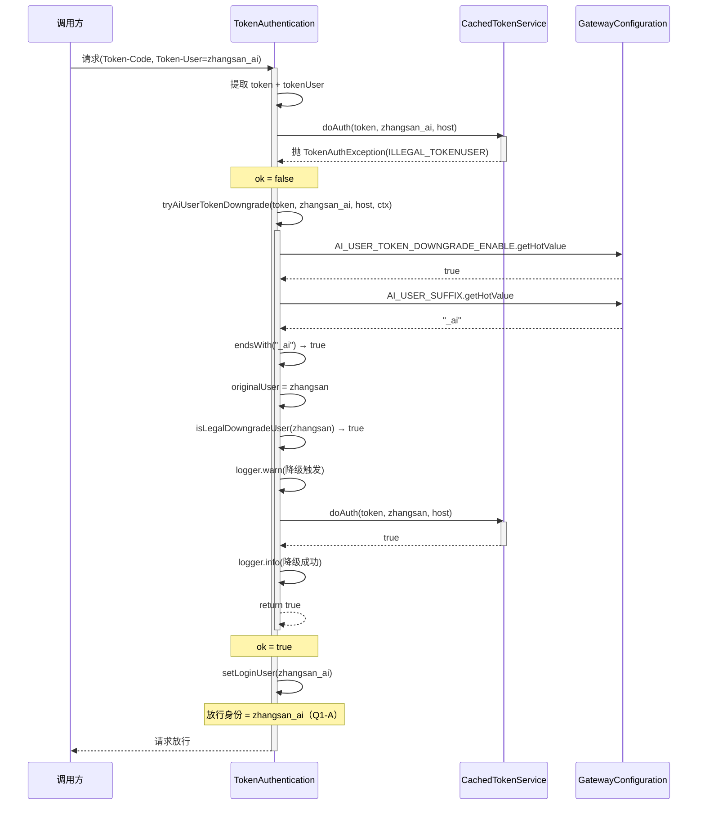
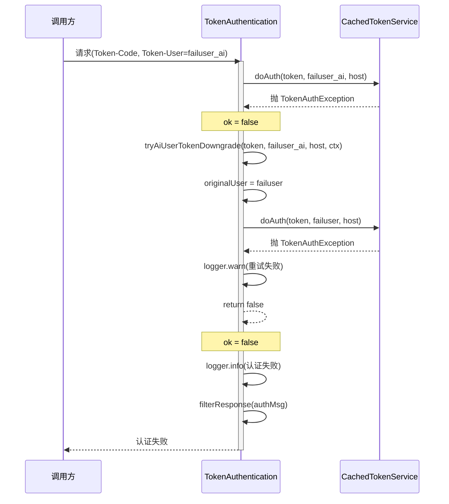
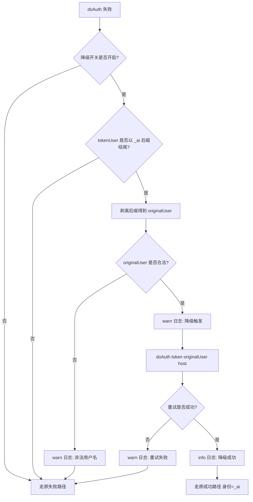

> 石墨文档链接：[点击查看](http://docs.weoa.com/docs/gXqmeOjD6eIzxWqo)

# 网关 _ai 用户 token 降级鉴权 设计文档

**需求类型**: FEATURE（业务需求）
**风险等级**: 低风险（DPMS 评定）
**文档版本**: v1.0
**创建日期**: 2026-09-24
**需求来源**: DPMS Story #548689（产品 100484 / BDP_Linkis）
**所属版本**: Linkis 2.1.4（分支 `dev-2.1.4-webank`）
**功能属性**: 后端（不涉及前端）
**关联需求文档**: [gateway-ai-user-token-downgrade_需求.md](../requirements/gateway-ai-user-token-downgrade_需求.md)

---

## 0. 执行摘要

| 维度 | 内容 |
|------|------|
| **需求概述** | 企金 MCP 通道将调用用户统一切换为 `<user>_ai`，`_ai` 用户在 token 体系无记录时网关认证失败。本需求在网关侧提供降级能力：`_ai` 用户认证失败时剥离后缀用原用户 token 重试鉴权一次 |
| **改造范围** | linkis-mg-gateway（linkis-gateway-core 单模块），仅 `TokenAuthentication.scala` 一条链路 |
| **关键决策** | 降级仅解决凭证问题，放行身份保持 `_ai` 用户（Q1-A 方案）；开关支持热加载（`getHotValue`） |
| **开关** | `wds.linkis.gateway.ai.user.token.downgrade.enable`，默认 `false`，支持运行时关停不重启 |
| **关键风险** | 低（开关默认关、仅失败路径生效、单次重试、`Utils.tryCatch` 全程保护、`_ai` 后缀+用户名合法性双重校验） |

---

## 1. 设计背景

### 1.1 业务背景

企金 MCP 通道将调用用户统一切换为独立身份 `<user>_ai`（实名/系统用户均切换，切换动作在 MCP 端完成）。切换后的 `_ai` 用户到达 Linkis 网关时，因 token 体系（`linkis_token` 表）中**没有 `<user>_ai` 的记录**，token 认证（`doAuth`）直接失败，请求被拒——这是 `_ai` 通道接入 Linkis 的**第一道阻塞点**。

本需求在网关侧提供降级能力：`_ai` 用户认证失败时，剥离后缀改用**原用户自己的 token** 重试鉴权，让 `_ai` 用户无需独立 token 记录即可通过网关。

### 1.2 认证链路现状

当前 `tokenAuth` 完整流程（`TokenAuthentication.scala:55-184`）：

```
tokenAuth(gatewayContext, login)
 ├─ ENABLE_TOKEN_AUTHENTICATION 检查（生产 enable.token.auth=true 已启用）  :56
 ├─ 从 Header / Cookie 提取 Token-Code + Token-User                        :62-93
 ├─ tokenAlive 参数处理                                                     :94-109
 ├─ 动态 token 前缀路由 → dynamicTokenAuth（不走静态 doAuth） :110-113
 ├─ 静态 token 认证：tokenService.doAuth(token, tokenUser, host)   :118
 │    ├─ 失败 → 构造 noLogin 报错                           :115-123
 │    │         └─ filterResponse 返回认证失败               :164
 │    └─ 成功 →                                            :124
 │         ├─ 动态 token 签发请求分支                        :130-137
 │         ├─ login 模式：setLoginUser(tokenUser)           :139-149
 │         └─ 常规模式：GatewaySSOUtils.setLoginUser(       :150-157
 │              request, tokenUser, tokenAlive)
 │              ★ 放行身份 = tokenUser（关键语义）
 └─ 日志：入口 / 成功 / 失败（token 均已 maskToken 脱敏）
```

| # | 现状要点 | 锚点 | 对本需求的意义 |
|---|---------|------|--------------|
| 1 | doAuth 失败即拒绝，无任何降级路径 | `TokenAuthentication.scala:118-123` + `:164` | 降级逻辑的唯一切入点 |
| 2 | token-user 不匹配抛 `TokenAuthException(ILLEGAL_TOKENUSER)` | `CachedTokenService.scala:226-231` | `_ai` 用户必然命中此异常（表无记录/用户不匹配） |
| 3 | 认证成功后放行身份 = tokenUser | `TokenAuthentication.scala:150-157`（`setLoginUser`） | 降级后请求身份是谁——首要设计分叉（Q1） |
| 4 | 动态 token（前缀路由）不走静态 doAuth | `TokenAuthentication.scala:110-113` | 降级范围边界：仅静态 token 路径 |
| 5 | token 可来自 Header 或 Cookie | `TokenAuthentication.scala:62-93` | 降级判断在提取之后，两种来源均覆盖 |
| 6 | 既有 token 脱敏日志规范 | `TokenSensitiveUtils.maskToken`（linkis-common） | 降级日志直接复用 |
| 7 | 网关既有用户映射机制 | `ProxyUserUtils` + `GatewayConfiguration.ENABLE_PROXY_USER` | 开关命名与实现形态参考 |

### 1.3 doAuth 异常分支分析

`CachedTokenService.doAuth`（`:215-241`）按顺序校验三项，任一失败即抛 `TokenAuthException`：

| # | 校验项 | 异常码 | 触发条件 | `_ai` 用户命中概率 | 是否适用降级 |
|---|--------|--------|---------|-------------------|:----------:|
| 1 | token 有效性 | `TOKEN_IS_EXPIRED` | token 不存在或已过期 | 中（若原用户 token 也过期则不适用） | ✅（重试时原用户 token 也过期会自然失败） |
| 2 | 用户匹配性 | `ILLEGAL_TOKENUSER` | token 存在但 userName 不在绑定用户列表 | **高（`_ai` 用户必然命中）** | ✅（核心降级场景） |
| 3 | 主机匹配性 | `ILLEGAL_HOST` | token 和用户匹配但请求 IP 不在允许列表 | 低 | ✅（重试时原用户 IP 策略可能不同） |

**设计决策**：降级不按异常类型过滤，而是统一在 `doAuth` 失败后触发。理由：
- `_ai` 用户最常见命中 `ILLEGAL_TOKENUSER`（token 有效但用户不匹配），降级后用原用户重试可成功
- `TOKEN_IS_EXPIRED` 场景降级重试时，原用户 token 同样过期会自然失败，不会造成误放行
- `ILLEGAL_HOST` 场景降级重试时，原用户 IP 策略可能不同，允许通过
- 按异常类型过滤会增加代码复杂度且无法覆盖所有边界（如 `TokenNotExistException` 转换为 `TokenAuthException` 的路径），统一触发 + 单次重试 + 原用户也失败则走原失败路径，语义更安全

---

## 2. 设计方案

### 2.1 整体架构

**改造前**：
```
tokenAuth
  ├─ doAuth(token, tokenUser, host)
  │    ├─ 失败 → noLogin + filterResponse（无降级路径）
  │    └─ 成功 → setLoginUser(tokenUser) + 后续分支
```

**改造后**：
```
tokenAuth
  ├─ doAuth(token, tokenUser, host)
  │    ├─ 失败 → tryAiUserTokenDowngrade(token, tokenUser, host, gatewayContext)
  │    │    ├─ 降级不适用（开关关/非_ai后缀/用户名非法） → 返回 false → 走原失败路径
  │    │    ├─ 降级重试成功 → 返回 true → 走原成功路径（身份仍为 _ai）
  │    │    └─ 降级重试失败/异常 → 返回 false → 走原失败路径
  │    └─ 成功 → setLoginUser(tokenUser) + 后续分支（行为不变）
```

**核心设计原则**：
- 降级仅解决**凭证问题**，不改变放行身份（Q1-A 方案）
- 降级逻辑在 `TokenAuthentication` 上层处理，**不改 `CachedTokenService`** 对外行为
- 全程 `Utils.tryCatch` 保护，任何异常回退现网原报错路径
- 开关默认关闭，关闭时降级代码零生效

### 2.2 修改文件清单

| 序号 | 文件路径 | 修改类型 | 修改内容 |
|:----:|---------|:--------:|---------|
| 1 | `GatewayConfiguration.scala` | 修改 | 新增 `AI_USER_TOKEN_DOWNGRADE_ENABLE` 和 `AI_USER_SUFFIX` 两个配置项 |
| 2 | `TokenAuthentication.scala` | 修改 | 新增 `tryAiUserTokenDowngrade` 和 `isLegalDowngradeUser` 方法；在 doAuth 失败分支后插入降级调用 |
| 3 | `linkis-mg-gateway.properties` | 修改 | 添加降级开关注释行（默认关也写出来，便于运维感知） |
| 4 | `TokenAuthenticationAiDowngradeTest.scala` | 新增 | 单测覆盖 AC1-AC7 + Q2 后缀可配置 + 安全校验 |

### 2.3 复用决策表

| 现有资产 | 复用/新建 | 理由 |
|---------|:--------:|------|
| `Utils.tryCatch` | 复用 | 项目统一异常保护工具，降级全程包裹 |
| `CommonVars` / `getHotValue` | 复用 | 项目统一配置开关声明工具，`getHotValue` 支持运行时关停 |
| `TokenSensitiveUtils.maskToken` | 复用 | 既有 token 脱敏工具，含单测，降级日志直接复用 |
| `GatewaySSOUtils.setLoginUser` | 复用 | 既有放行身份设置，降级成功后走原路径调用 |
| `StringUtils.isBlank` / `endsWith` | 复用 | Apache Commons Lang3，后缀判断与用户名校验 |
| `GatewayConfiguration` | 扩展 | 新增两个配置项，命名对齐既有惯例 |
| `TokenAuthentication` | 扩展 | 新增 `tryAiUserTokenDowngrade` + `isLegalDowngradeUser` 两个私有方法 |
| `CachedTokenService` | 不修改 | 对外抛错语义保持不变，降级在上层处理 |
| `SecurityFilter.filterResponse` | 不修改 | 失败兜底走现网原路径 |
| `ProxyUserUtils` | 不修改 | 参考其实现形态，但不复用（降级是纯后缀剥离，更简单） |
| 数据库表/Mapper | 不涉及 | 无数据库变更 |

---

## 3. 详细设计

### 3.1 GatewayConfiguration - 新增配置项

**修改位置**: `linkis-spring-cloud-services/linkis-service-gateway/linkis-gateway-core/src/main/scala/org/apache/linkis/gateway/config/GatewayConfiguration.scala`

**修改内容**: 在 `GatewayConfiguration` object 末尾新增两个配置项

```scala
// ============================================================
// AI User Token Downgrade Authentication Configuration
// ============================================================

/**
 * Switch of AI user token downgrade authentication, default disabled. When enabled, if a
 * tokenUser ending with the AI user suffix(e.g. zhangsan_ai) fails token authentication, the
 * gateway will strip the suffix and retry doAuth once with the original user(e.g. zhangsan) using
 * the same token, so AI users can pass the gateway with the original user's token. The login
 * identity still keeps the AI tokenUser, only the credential check is downgraded.
 *
 * Read via getHotValue so that it can be turned off at runtime without restarting the gateway.
 */
val AI_USER_TOKEN_DOWNGRADE_ENABLE =
  CommonVars("wds.linkis.gateway.ai.user.token.downgrade.enable", false)

/**
 * Suffix of AI proxy users(e.g. zhangsan_ai), configurable to avoid code change when the suffix
 * needs to be adjusted.
 */
val AI_USER_SUFFIX = CommonVars("wds.linkis.gateway.ai.user.suffix", "_ai")
```

**设计要点**:
- key 命名对齐网关既有惯例：`wds.linkis.gateway.*.enable`（与 `ENABLE_PROXY_USER`/`ENABLE_TOKEN_AUTHENTICATION` 一致）
- 默认值 `false`，遵循 CLAUDE.md §4.1.1 铁律（新功能开关默认关闭）
- 使用 `CommonVars` 声明，读取时用 `getHotValue` 以支持运行时关停不重启（Q3 决策）
- `AI_USER_SUFFIX` 独立配置，避免后缀变更时改代码（Q2 决策）

### 3.2 TokenAuthentication - 降级逻辑实现

**修改位置**: `linkis-spring-cloud-services/linkis-service-gateway/linkis-gateway-core/src/main/scala/org/apache/linkis/gateway/security/token/TokenAuthentication.scala`

#### 3.2.1 在 doAuth 失败分支后插入降级调用

在 `tokenAuth` 方法的 doAuth 失败分支（`:118-123`）之后、成功分支（`:141`）之前，插入降级调用：

```scala
var ok: Boolean = Utils.tryCatch(tokenService.doAuth(token, tokenUser, host))(t => {
  authMsg = Message.noLogin(
    s"Token Authentication Failed, token: $token，tokenUser: $tokenUser, reason: ${t.getMessage}"
  ) << gatewayContext.getRequest.getRequestURI
  false
})
// AI user token downgrade: when a tokenUser with the AI suffix(e.g. zhangsan_ai) fails
// token auth, strip the suffix and retry doAuth once with the original user(e.g.
// zhangsan) using the same token. Only the credential check is downgraded, the login
// identity still keeps the AI tokenUser. Any exception falls back to the original
// auth-failure behavior.
if (!ok) {
  Utils.tryCatch {
    ok = tryAiUserTokenDowngrade(token, tokenUser, host, gatewayContext)
  } { t =>
    logger.warn(
      s"token downgrade: AI user token downgrade failed with exception, fallback to " +
        s"original auth failure path, tokenUser: $tokenUser, uri: ${gatewayContext.getRequest.getRequestURI}.",
      t
    )
    ok = false
  }
}
```

**设计要点**:
- 降级调用外层再包一层 `Utils.tryCatch`，确保降级逻辑自身的异常也不会污染主链路
- 降级返回 `false` 时 `ok` 保持 `false`，自然走原失败路径（noLogin + filterResponse）
- 降级返回 `true` 时 `ok` 变为 `true`，自然走原成功路径（setLoginUser 等），**身份仍为 `tokenUser`（即 `_ai` 用户）**

#### 3.2.2 新增 tryAiUserTokenDowngrade 方法

```scala
/** Max length of the original user stripped from an AI tokenUser. */
private val DOWNGRADE_USER_MAX_LENGTH = 64

/** Illegal chars in a stripped original user: path separators and wildcards. */
private val ILLEGAL_DOWNGRADE_USER_CHARS = "\\/:*?\"<>|"

/**
 * Try AI user token downgrade authentication.
 *
 * Triggered only when all of the following hold: ① the downgrade switch is enabled; ② tokenUser
 * ends with the configured AI user suffix(e.g. zhangsan_ai); ③ the direct doAuth for the AI user
 * has just failed, e.g. there is no token record for it. Strip the suffix to get the original
 * user(e.g. zhangsan), then retry doAuth at most once with the same token, so an AI user can pass
 * the gateway with the original user's token. The login identity is NOT rewritten: on success the
 * request still carries the AI tokenUser.
 */
private[token] def tryAiUserTokenDowngrade(
    token: String,
    tokenUser: String,
    host: String,
    gatewayContext: GatewayContext
): Boolean = {
  if (!GatewayConfiguration.AI_USER_TOKEN_DOWNGRADE_ENABLE.getHotValue) {
    return false
  }
  val aiSuffix = GatewayConfiguration.AI_USER_SUFFIX.getHotValue
  if (StringUtils.isBlank(aiSuffix) || !tokenUser.endsWith(aiSuffix)) {
    return false
  }
  val originalUser = tokenUser.substring(0, tokenUser.length - aiSuffix.length)
  if (!isLegalDowngradeUser(originalUser)) {
    logger.warn(
      s"token downgrade: illegal original user stripped from tokenUser $tokenUser, " +
        s"skip downgrade, uri: ${gatewayContext.getRequest.getRequestURI}."
    )
    return false
  }
  logger.warn(
    s"token downgrade: tokenUser $tokenUser failed token auth, retry doAuth with original " +
      s"user $originalUser, uri: ${gatewayContext.getRequest.getRequestURI}, token: ${TokenSensitiveUtils
        .maskToken(token)}, host: $host."
  )
  val retryOk: Boolean = Utils.tryCatch(tokenService.doAuth(token, originalUser, host)) { t =>
    logger.warn(
      s"token downgrade: retry doAuth with original user $originalUser failed, tokenUser: " +
        s"$tokenUser, uri: ${gatewayContext.getRequest.getRequestURI}, token: ${TokenSensitiveUtils
          .maskToken(token)}, reason: ${t.getMessage}."
    )
    false
  }
  if (retryOk) {
    logger.info(
      s"token downgrade: tokenUser $tokenUser passed auth with original user $originalUser's " +
        s"token, uri: ${gatewayContext.getRequest.getRequestURI}."
    )
  }
  retryOk
}
```

**设计要点**:

| 步骤 | 逻辑 | 异常保护 |
|------|------|---------|
| 1. 开关检查 | `AI_USER_TOKEN_DOWNGRADE_ENABLE.getHotValue` | 开关关闭直接返回 false |
| 2. 后缀检查 | `AI_USER_SUFFIX.getHotValue` + `endsWith` | 后缀为空或不匹配返回 false |
| 3. 后缀剥离 | `substring(0, len - suffixLen)` | 纯字符串操作，无异常风险 |
| 4. 用户名合法性校验 | `isLegalDowngradeUser` | 非法用户名返回 false + warn 日志 |
| 5. 降级重试 | `Utils.tryCatch(doAuth(token, originalUser, host))` | 异常捕获，返回 false |
| 6. 结果返回 | `retryOk` | 成功 true / 失败 false |

**Q1 决策体现**：方法只返回 `Boolean`，不返回用户名。调用方 `tokenAuth` 拿到 `true` 后走原成功路径，`setLoginUser` 使用的仍是原始 `tokenUser`（`_ai` 用户），**身份不被改写**。

#### 3.2.3 新增 isLegalDowngradeUser 安全校验方法

```scala
/**
 * Validate the original user stripped from an AI tokenUser: not blank, not too long, no
 * whitespace, path separators, wildcards or `..`, to prevent malformed usernames from bypassing
 * the downgrade.
 */
private def isLegalDowngradeUser(user: String): Boolean = {
  StringUtils.isNotBlank(user) && user.length <= DOWNGRADE_USER_MAX_LENGTH &&
  !user.contains("..") && !user.exists(c =>
    c.isWhitespace || ILLEGAL_DOWNGRADE_USER_CHARS.indexOf(c) >= 0
  )
}
```

**安全校验规则**:

| 校验项 | 规则 | 防护目的 |
|--------|------|---------|
| 非空 | `isNotBlank(user)` | 防止后缀即全部用户名（如 `_ai` → 剥离后为空） |
| 长度限制 | `length <= 64` | 防止超长用户名攻击 |
| 路径穿越 | `!contains("..")` | 防止 `../` 形式的路径穿越 |
| 空白字符 | `!exists(c.isWhitespace)` | 防止空格/制表符等隐藏字符 |
| 非法字符 | `!exists(c in ILLEGAL_DOWNGRADE_USER_CHARS)` | 防止 `\/:*?"<>\|` 等路径分隔符和通配符 |

`ILLEGAL_DOWNGRADE_USER_CHARS = "\\/:*?\"<>|"` 覆盖 Windows 路径分隔符、Unix 路径分隔符、通配符等。

### 3.3 配置文件变更

**修改位置**: `linkis-dist/package/conf/linkis-mg-gateway.properties`

**新增内容**:

```properties
# === AI 用户 token 降级鉴权开关（默认关闭）===
# 开启后，_ai 后缀用户 token 认证失败时，剥离后缀用原用户 token 重试鉴权一次
# 仅适用于静态 token 认证路径，动态 token（前缀路由）不走降级
# 降级仅解决凭证问题，放行身份保持 _ai 用户
# 支持运行时关停（getHotValue），无需重启网关
# wds.linkis.gateway.ai.user.token.downgrade.enable=false

# === AI 用户后缀（默认 _ai）===
# 可配置，避免后缀变更时改代码
# wds.linkis.gateway.ai.user.suffix=_ai
```

---

## 4. 开放问题决策记录（Q1-Q6）

### Q1: 降级成功后，请求放行身份是谁？

**决策：方案 A — 仅凭证降级，身份保持 `_ai` 用户**

| 维度 | 方案 A（选中） | 方案 B |
|------|-------------|--------|
| 语义 | doAuth 用原用户，setLoginUser 仍写 `_ai` | 身份也改写为原用户 |
| 隔离目的 | 保持 AI 通道隔离，jobhistory 记 `_ai` | 隔离失效，`_ai` 切换失去意义 |
| 改动面 | 只影响 doAuth 参数，setLoginUser 不变 | 需改写 tokenUser 变量，影响后续所有分支 |
| 下游一致性 | jobhistory/引擎以 `_ai` 拉起，与 MCP 端预期一致 | 下游看到原用户，与 MCP 端 `_ai` 切换语义冲突 |

**代码体现**: `tryAiUserTokenDowngrade` 只返回 `Boolean`，不返回用户名。`tokenAuth` 拿到 `true` 后走原成功路径，`setLoginUser` 使用原始 `tokenUser`。

### Q2: `_ai` 后缀是否配置化？

**决策：配置化，默认 `_ai`**

新增 `AI_USER_SUFFIX` 配置项（`wds.linkis.gateway.ai.user.suffix`，默认 `_ai`），成本极低且避免后缀变更时改代码。单测 `configurableSuffix` 验证：改为 `_bot` 后 `zhangsan_bot` 触发降级，`zhangsan_ai` 不再触发。

### Q3: 开关是否要求热加载？

**决策：要求热加载，使用 `getHotValue`**

鉴权链路出问题时重启网关代价高，使用 `getHotValue` 支持运行时关停。两个配置项均通过 `getHotValue` 读取：
- `AI_USER_TOKEN_DOWNGRADE_ENABLE.getHotValue`
- `AI_USER_SUFFIX.getHotValue`

### Q4: 降级审计口径？

**决策：仅日志，与现网 token 认证审计口径一致**

降级事件通过 `logger.warn` / `logger.info` 记录，包含四要素：
- 触发用户（`_ai` 用户）
- 降级目标用户（原用户）
- 结果（成功/失败/异常）
- URI

token 全程经 `TokenSensitiveUtils.maskToken` 脱敏。无需额外落库或上报。

### Q5: 原用户 token 已过期/禁用场景是否适用降级？

**决策：统一触发，不过滤异常类型，重试自然失败**

`doAuth` 的三种异常（`TOKEN_IS_EXPIRED`/`ILLEGAL_TOKENUSER`/`ILLEGAL_HOST`）均触发降级重试。若原用户 token 也过期，重试时 `doAuth` 会再次抛 `TOKEN_IS_EXPIRED`，降级自然失败，走原失败路径。不会造成误放行。

不按异常类型过滤的理由：
- `_ai` 用户最常见命中 `ILLEGAL_TOKENUSER`，这是核心降级场景
- `TOKEN_IS_EXPIRED` 场景重试自然失败，安全
- `ILLEGAL_HOST` 场景原用户 IP 策略可能不同，允许通过
- 过滤异常类型增加代码复杂度且无法覆盖所有边界

### Q6: `_ai` 用户后续拥有独立 token 记录时的先后顺序？

**决策：降级永远只在 `_ai` 直查失败后触发，天然兼容**

`tokenAuth` 先对 `tokenUser`（`_ai` 用户）直查 `doAuth`，失败后才触发降级。未来若 `_ai` 用户拥有独立 token 记录，直查成功则不降级。二者天然兼容，无需额外处理。

---

## 5. 关键设计决策记录（ADR）

### ADR-01: 为什么选择方案 A（仅凭证降级）而非方案 B（身份也改写）

| 维度 | 方案 A（选中） | 方案 B |
|------|-------------|--------|
| 隔离目的 | 保持 `_ai` 通道隔离 | 隔离失效 |
| 改动面 | 仅 doAuth 参数 | 需改写 tokenUser |
| 下游一致性 | jobhistory/引擎以 `_ai` 拉起 | 下游看到原用户 |
| 安全 | 凭据始终是原用户 token，不扩大权限面 | 身份改写后可能获得原用户权限 |

### ADR-02: 为什么不改 CachedTokenService

| 维度 | 不改（选中） | 改 CachedTokenService |
|------|-------------|---------------------|
| 对外行为 | 保持不变 | 抛错语义可能变化 |
| 影响面 | 仅 TokenAuthentication | 所有调用 CachedTokenService 的模块 |
| 回滚 | 开关关闭即回滚 | 需回滚 CachedTokenService 改动 |

### ADR-03: 为什么使用 getHotValue 而非 getValue

| 维度 | getHotValue（选中） | getValue |
|------|-------------|---------|
| 运行时关停 | 支持，不重启网关 | 需重启 |
| 生产止血 SLA | 秒级（热加载间隔） | 分钟级（重启网关） |
| 性能 | 每次读热加载缓存 | 首次后用 JVM 快照 |
| 决策理由 | 鉴权链路出问题时重启代价高，热加载优先 | — |

### ADR-04: 为什么统一触发降级而非按异常类型过滤

| 维度 | 统一触发（选中） | 按异常类型过滤 |
|------|-------------|--------------|
| 代码复杂度 | 低 | 高（需解析异常类型） |
| 覆盖边界 | 全覆盖 | 可能遗漏边界（如 TokenNotExistException） |
| 安全 | 重试自然失败，不会误放行 | 需精确枚举可降级异常 |
| 决策理由 | `_ai` 用户核心场景是 ILLEGAL_TOKENUSER，统一触发+单次重试+自然失败语义更安全 | — |

### ADR-05: 为什么新增 isLegalDowngradeUser 安全校验

| 维度 | 有校验（选中） | 无校验 |
|------|-------------|--------|
| 安全 | 防止畸形用户名构造绕过 | 可能被路径穿越/通配符攻击 |
| 成本 | 纯字符串检查，O(n) | 0 |
| 决策理由 | CLAUDE.md §4.1.1 要求安全检查，需求文档 §3 安全要求 ③ 明确要求 | — |

---

## 6. 降级流程时序图

### 6.1 降级成功时序



### 6.2 降级失败时序



### 6.3 关键节点说明表

| 节点 | 处理逻辑 | 输入/输出 | 异常处理 |
|-----|---------|----------|---------|
| 1. doAuth 首次 | `tokenService.doAuth(token, tokenUser, host)` | 输入: token+`_ai`用户+host<br>输出: Boolean | `Utils.tryCatch` 包裹，异常时 ok=false |
| 2. 降级开关检查 | `AI_USER_TOKEN_DOWNGRADE_ENABLE.getHotValue` | 输出: Boolean | 开关关闭返回 false |
| 3. 后缀检查 | `AI_USER_SUFFIX.getHotValue` + `endsWith` | 输出: Boolean | 后缀不匹配返回 false |
| 4. 后缀剥离 | `substring(0, len - suffixLen)` | 输出: originalUser | 纯字符串操作 |
| 5. 用户名合法性 | `isLegalDowngradeUser` | 输出: Boolean | 非法返回 false + warn |
| 6. doAuth 重试 | `Utils.tryCatch(doAuth(token, originalUser, host))` | 输出: Boolean | 异常捕获，返回 false |
| 7. 放行身份 | `setLoginUser(tokenUser)` | 输入: `_ai`用户 | 身份保持 `_ai`（Q1-A） |

### 6.4 降级判断决策流程图



---

## 7. 影响范围分析

| 维度 | 影响等级 | 说明 |
|------|:--------:|------|
| 功能影响 | 轻微 | 在 `TokenAuthentication` 内部增加降级逻辑，不修改任何公开接口签名 |
| 接口影响 | 无 | 不修改任何 RESTful API |
| 数据模型影响 | 无 | 不涉及数据库表结构变更 |
| 上下游影响 | 无 | 不影响上下游系统，MCP 端降级独立仓库独立实现 |
| 性能影响 | 极小 | 降级仅位于认证失败路径（正常流量不经过）；单次后缀判断 + 至多一次 doAuth 重试，O(1) |
| 安全影响 | 无 | 降级不是认证旁路：三重限定（开关+后缀+失败）+ 单次重试 + 凭据仍属原用户 + 用户名合法性校验 |
| 兼容性 | 完全 | 开关默认关闭时与现网行为逐字节一致；非 `_ai` 用户零影响；动态 token 路径零影响 |

---

## 8. 测试策略

### 8.1 单元测试场景

| 场景ID | 测试场景 | 前置条件 | 预期结果 | 验证点 |
|:------:|---------|---------|---------|--------|
| AC1 | 开关关闭 + `_ai` 用户 doAuth 失败 | 开关=false | 不触发降级，doAuth 不重试 | `tryAiUserTokenDowngrade` 返回 false，`verify(tokenService, never()).doAuth(...)` |
| AC2 | 开关开启 + `zhangsan_ai` doAuth 失败 → 重试 `zhangsan` 成功 | 开关=true，重试返回 true | 降级成功，重试一次 | `tryAiUserTokenDowngrade` 返回 true，`verify(tokenService, times(1)).doAuth(eqTo("T"), eqTo("zhangsan"), eqTo("h"))` |
| AC3 | 开关开启 + 原用户重试也失败 | 开关=true，重试返回 false | 降级失败，无第二次重试 | 返回 false，`verify(tokenService, times(1)).doAuth(...)` |
| AC4 | 非 `_ai` 后缀用户不触发降级 | 开关=true，`zhangsan`/`zhangsan_ai2` | 不触发降级 | 返回 false，`verify(tokenService, never()).doAuth(...)` |
| AC5 | doAuth 抛异常 → 捕获，返回 false | 开关=true，doAuth 抛 RuntimeException | 异常不传播，返回 false | `Assertions.assertFalse(ok)`，无异常抛出 |
| AC6 | 畸形用户名（空/路径分隔/`..`/空格/通配符）→ 跳过降级 | 开关=true，`_ai`/`a/b_ai`/`a/../b_ai`/`a b_ai`/`a*b_ai` | 跳过降级，doAuth 不调用 | 返回 false，`verify(tokenService, never()).doAuth(...)` |
| AC7 | 并发 `_ai` 请求独立正确，无串扰 | 开关=true，15 成功 + 15 失败，30 线程并发 | 各请求结果独立正确 | 成功组 true，失败组 false，调用次数=30 |
| Q2 | 后缀可配置：`_bot` 触发 `zhangsan_bot` 降级 | 开关=true，suffix=`_bot` | `zhangsan_bot` 降级成功，`zhangsan_ai` 不再触发 | `verify(tokenService).doAuth(eqTo("T"), eqTo("zhangsan"), eqTo("h"))` |

**单测文件**: `TokenAuthenticationAiDowngradeTest.scala`（已实现，位于 `linkis-gateway-core/src/test/scala/.../security/token/`）

**单测设计要点**:
- 开关和后缀通过 `System.setProperty` 控制（`getHotValue` 读 Java 系统属性），`@BeforeEach`/`@AfterEach` 清理
- 并发测试用 `CountDownLatch` + `ConcurrentHashMap` + 线程安全 `RecordingTokenService`
- 畸形用户名覆盖空、路径分隔符、`..`、空格、通配符五类

### 8.2 集成测试场景

| 场景ID | 测试场景 | 前置条件 | 预期结果 |
|:------:|---------|---------|---------|
| IT-01 | 开关关闭 + `_ai` 用户请求 | 开关=false | 行为与现网完全一致，认证失败 |
| IT-02 | 开关开启 + `zhangsan_ai`（表无记录）+ 原用户 token 有效 | 开关=true | 降级成功，请求放行，身份=zhangsan_ai |
| IT-03 | 开关开启 + `zhangsan_ai` + 原用户 token 也无效 | 开关=true | 降级失败，认证失败报错 |
| IT-04 | 开关开启 + 非 `_ai` 用户认证失败 | 开关=true | 不触发降级，认证失败 |
| IT-05 | 开关开启 + 动态 token（`dyn-` 前缀）+ `_ai` 用户 | 开关=true | 走 `dynamicTokenAuth`，降级不介入 |
| IT-06 | 开关开启→关闭切换 | 运行时切换 | 行为随开关即时正确切换（热加载） |
| IT-07 | 开关开启 + login 模式 + `tokenAlive` 参数 | 开关=true | 降级成功后各分支行为一致 |

### 8.3 回归测试范围

| 范围 | 测试内容 |
|------|---------|
| 非 `_ai` 用户 token 认证 | 普通 token 请求不受影响 |
| 动态 token 认证 | `dyn-` 前缀路由不受影响 |
| Cookie 来源 token | Cookie 中的 token 降级同样覆盖 |
| 网关全量回归 | 开关 on/off 双态全量 token 认证回归 |

---

## 9. 发布与回滚方案

### 9.1 发布策略

| 维度 | 方案 |
|------|------|
| 发布类型 | 灰度发布（与版本整体策略一致） |
| 灰度步骤 | 1. BDAP-DEV 测试环境部署验证<br>2. SIT/UAT 环境验证 `_ai` 通道<br>3. 生产灰度金监局环境<br>4. 手动设置 `wds.linkis.gateway.ai.user.token.downgrade.enable=true` 开启降级 |
| 发布窗口 | 非业务高峰期 |
| 前置条件 | MCP 端 `_ai` 切换功能已就绪；网关降级开关先开或与 MCP 端同时开 |

### 9.2 回滚方案

| 维度 | 方案 |
|------|------|
| 回滚触发条件 | 开启降级后出现认证异常率上升或其他回归问题 |
| 回滚步骤 | 1. 设置 `wds.linkis.gateway.ai.user.token.downgrade.enable=false`<br>2. 无需重启网关（`getHotValue` 热加载）<br>3. 行为回退到现网原状态 |
| 回滚时间 | 配置修改，秒级生效 |
| 回滚验证 | `_ai` 用户认证恢复原失败行为，非 `_ai` 用户不受影响 |

### 9.3 监控方案

| 监控指标 | 采集方式 | 告警阈值 |
|---------|---------|---------|
| `_ai` 用户认证成功率 | 网关日志统计 | 成功率异常下降告警 |
| 降级触发次数 | 日志中 `token downgrade: tokenUser .* failed token auth` 出现次数 | 非预期激增告警 |
| 降级成功次数 | 日志中 `token downgrade: tokenUser .* passed auth` 出现次数 | — |
| 降级失败次数 | 日志中 `retry doAuth with original user .* failed` 出现次数 | 持续失败告警 |
| 降级异常次数 | 日志中 `AI user token downgrade failed with exception` 出现次数 | > 0 告警 |

---

## 10. 变更后验证方法

### 10.1 功能验证

| 验证项 | 验证方法 | 预期结果 |
|--------|---------|---------|
| 开关关闭行为不变 | 关闭开关，`_ai` 用户请求 | 认证失败，行为与现网一致 |
| 降级成功 | 开启开关，`zhangsan_ai`（无 token 记录）+ `zhangsan` token 有效 | 请求放行，身份=`zhangsan_ai` |
| 降级失败 | 开启开关，`failuser_ai` + `failuser` token 也无效 | 认证失败，无第二次重试 |
| 非 `_ai` 不触发 | 开启开关，`zhangsan` 认证失败 | 不触发降级 |
| 动态 token 不介入 | 开启开关，`dyn-xxx` token + `_ai` 用户 | 走 `dynamicTokenAuth` |
| 热加载关停 | 运行时关闭开关 | 行为即时回退 |
| 并发独立 | 30 线程并发 `_ai` 请求 | 各请求结果独立正确 |

### 10.2 安全验证

| 验证项 | 验证方法 | 预期结果 |
|--------|---------|---------|
| token 脱敏 | 检查降级日志中 token 字段 | 均为 maskToken 脱敏形态，无明文 |
| 畸形用户名拦截 | `_ai`/`a/b_ai`/`a/../b_ai`/`a b_ai`/`a*b_ai` | 均跳过降级，doAuth 不调用 |
| 单次重试 | 原用户重试失败后 | 无第二次重试 |
| 身份保持 | 降级成功后 `setLoginUser` | 身份=`_ai` 用户，非原用户 |

### 10.3 日志验证

降级事件日志关键字：
- `token downgrade: tokenUser .* failed token auth` — 降级触发
- `token downgrade: tokenUser .* passed auth with original user` — 降级成功
- `token downgrade: retry doAuth with original user .* failed` — 降级重试失败
- `token downgrade: AI user token downgrade failed with exception` — 降级异常
- `token downgrade: illegal original user stripped from tokenUser` — 畸形用户名拦截

---

## 11. 异常与恢复

### 11.1 降级自身异常

| 异常场景 | 处理方式 | 恢复方法 |
|---------|---------|---------|
| 降级逻辑抛异常 | 外层 `Utils.tryCatch` 捕获，ok=false，走原失败路径 | 自动恢复，异常记录 warn 日志 |
| doAuth 重试抛异常 | `Utils.tryCatch` 捕获，retryOk=false | 走原失败路径 |
| 开关读取异常 | `getHotValue` 兜底返回默认值 false | 不触发降级 |
| 后缀为空 | `StringUtils.isBlank` 检查，返回 false | 不触发降级 |

### 11.2 降级不改变原失败行为

降级返回 `false` 时，`tokenAuth` 走原失败路径：
```scala
SecurityFilter.filterResponse(gatewayContext, authMsg)
```
`authMsg` 为 doAuth 失败时构造的 `Message.noLogin`，报错行为与现网一致。

### 11.3 降级不产生新错误形态

- 降级成功 → 走原成功路径（setLoginUser 等）
- 降级失败 → 走原失败路径（noLogin + filterResponse）
- 降级异常 → 走原失败路径
- 降级不适用 → 走原失败路径

**所有分支的终态都是现网既有路径，不产生新的错误形态或响应格式。**

---

## 12. 配置设计

### 12.1 新增配置项

| 配置 Key | 类型 | 默认值 | 说明 |
|---------|------|--------|------|
| `wds.linkis.gateway.ai.user.token.downgrade.enable` | Boolean | `false` | `_ai` 用户 token 降级鉴权开关 |
| `wds.linkis.gateway.ai.user.suffix` | String | `_ai` | AI 用户后缀（可配置） |

### 12.2 配置位置

| 位置 | 文件 | 说明 |
|------|------|------|
| 模块配置类 | `GatewayConfiguration.scala`（linkis-gateway-core） | 使用 `CommonVars` 声明 |
| 部署配置文件 | `linkis-mg-gateway.properties` | 添加注释行（默认关也写出） |

### 12.3 使用说明

```properties
# AI 用户 token 降级鉴权开关（默认关闭）
# 开启后，_ai 后缀用户 token 认证失败时，剥离后缀用原用户 token 重试鉴权一次
# 支持运行时关停（getHotValue），无需重启网关
# wds.linkis.gateway.ai.user.token.downgrade.enable=false

# AI 用户后缀（默认 _ai）
# wds.linkis.gateway.ai.user.suffix=_ai
```

开启方式（无需重启）：
```properties
wds.linkis.gateway.ai.user.token.downgrade.enable=true
```

---

## 13. 安全设计

### 13.1 降级不是认证旁路

降级安全性由三重限定保证：

| 限定条件 | 实现方式 | 失败时的行为 |
|---------|---------|------------|
| ① 开关开启 | `AI_USER_TOKEN_DOWNGRADE_ENABLE.getHotValue` | 开关关闭不触发降级 |
| ② `_ai` 后缀 | `tokenUser.endsWith(aiSuffix)` | 非 `_ai` 后缀不触发降级 |
| ③ 认证失败 | `if (!ok)` | 成功路径不触发降级 |

### 13.2 凭据不扩大权限面

降级重试使用**同一 token**，对**原用户**重试 `doAuth`。凭据始终是请求方携带的原用户 token，`_ai` 后缀仅决定"允许用哪个用户的身份去校验这枚 token"。

### 13.3 用户名合法性校验

`isLegalDowngradeUser` 防止畸形用户名构造绕过：
- 非空校验
- 长度限制（≤64）
- 路径穿越防护（`..`）
- 空白字符防护
- 路径分隔符/通配符防护（`\/:*?"<>\|`）

### 13.4 token 全链路脱敏

降级日志中所有 token 字段均经 `TokenSensitiveUtils.maskToken` 脱敏：
- 降级触发日志：`token: ${TokenSensitiveUtils.maskToken(token)}`
- 重试失败日志：`token: ${TokenSensitiveUtils.maskToken(token)}`
- 不打印其他用户敏感信息

### 13.5 单次重试

降级至多重试一次，`tryAiUserTokenDowngrade` 内部只调用一次 `doAuth`。无循环、无递归、无二次降级。

---

## 附录

### A.1 已核实代码锚点清单

| 锚点 | 位置 | 核实结论 |
|------|------|---------|
| tokenAuth 主流程 | `TokenAuthentication.scala:55-184` | 完整流程见 §1.2 |
| doAuth 失败分支（降级切入点） | `TokenAuthentication.scala:118-123` + `:164` | 失败即 noLogin + filterResponse，降级插入点 |
| 放行身份语义 | `TokenAuthentication.scala:150-157` | `setLoginUser(request, tokenUser)`——身份=tokenUser |
| 动态 token 路由 | `TokenAuthentication.scala:110-113` | 前缀路由不走静态 doAuth |
| token 双来源（Header/Cookie） | `TokenAuthentication.scala:62-93` | 降级判断在提取之后 |
| `ILLEGAL_TOKENUSER` 抛出点 | `CachedTokenService.scala:226-231` | `_ai` 用户直查必命中 |
| 开关声明惯例 | `GatewayConfiguration.scala` | `wds.linkis.gateway.*.enable` 惯例 |
| token 脱敏工具 | `TokenSensitiveUtils.java`（linkis-common） | `maskToken` 方法，含单测 |
| 异常保护工具 | `Utils.tryCatch`（linkis-common） | 降级全程包裹 |
| 热加载配置 | `CommonVars.getHotValue`（linkis-common） | 开关和后缀均用 `getHotValue` |

### A.2 单测覆盖矩阵

| 验收标准 | 单测方法 | 覆盖 |
|---------|---------|:----:|
| AC1 | `switchOffNoDowngrade` | ✅ |
| AC2 | `downgradeSuccess` | ✅ |
| AC3 | `downgradeRetryFails` | ✅ |
| AC4 | `nonAiUserNotTriggered` | ✅ |
| AC5 | `downgradeExceptionCaught` | ✅ |
| AC6（安全） | `malformedOriginalUser` | ✅ |
| AC7（并发） | `concurrentDowngrade` | ✅ |
| Q2（后缀可配置） | `configurableSuffix` | ✅ |

### A.3 关联文档

- 需求文档: [gateway-ai-user-token-downgrade_需求.md](../requirements/gateway-ai-user-token-downgrade_需求.md)
- DPMS Story #548689
- CLAUDE.md §4（新功能铁律：开关默认关 + tryCatch + 双态冒烟）
- 参考设计: `docs/dev-2.1.3/design/fix-hdfs-tgt-expired_设计.md`（文档格式参照）

---
