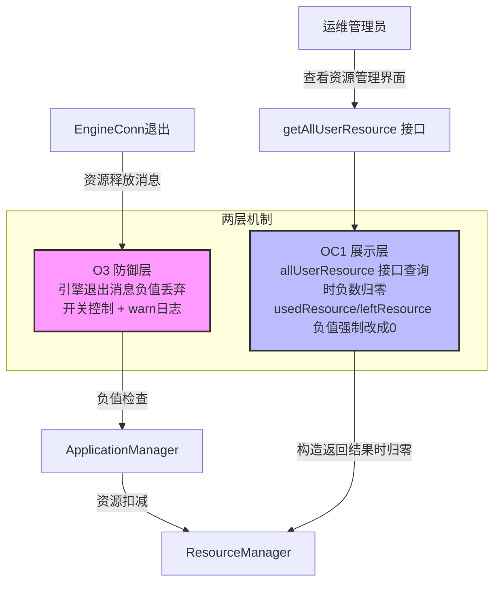
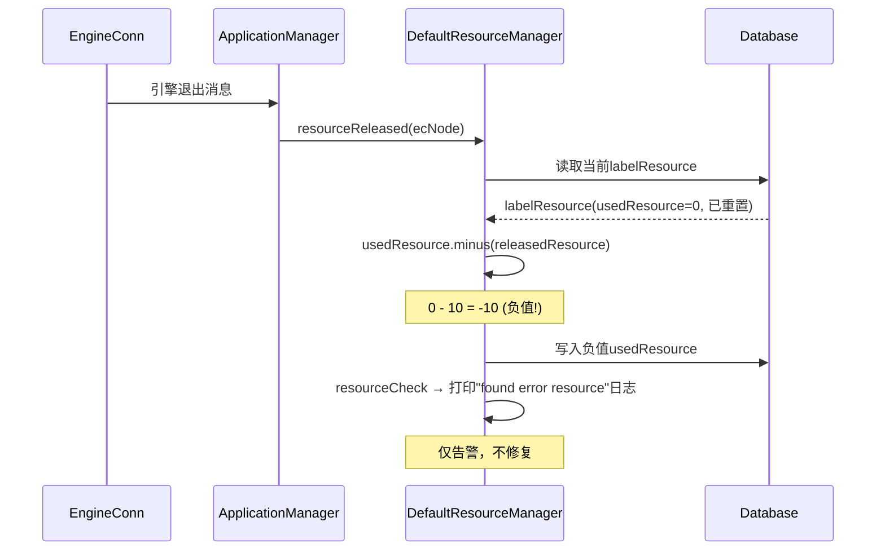
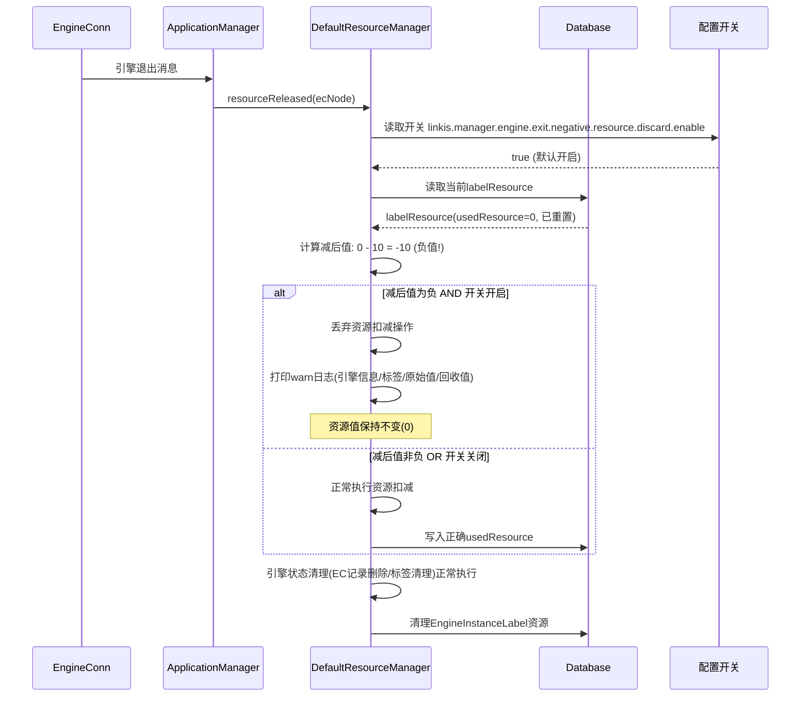

# 修复资源管理资源展示为负问题 设计文档

---

## 执行摘要

| 目标 | 描述 | 优先级 |
|-----|------|:------:|
| O3 引擎退出消息负值丢弃 | 引擎退出消息处理增加负值检查，丢弃负值扣减操作，开关控制 | P1 |
| OC1 资源管理界面查询负数归零 | allUserResource 接口查询时对 usedResource/leftResource 负数强制归零 | P1 |

| 决策点 | 选择方案 | 决策理由 | 替代方案 |
|-------|---------|---------|---------|
| 负值防御策略 | 丢弃负值扣减操作（非下限保护） | 丢弃操作识别残留EC，下限保护会掩盖数据不一致问题 | Resource.minus()方法加下限保护 |
| 开关默认值 | true（默认开启防御） | 需求明确要求默认开启，消除负值是核心目标 | 默认关闭，灰度发布后开启 |
| 展示层归零位置 | allUserResource 接口构造返回结果时归零 | 在查询出口统一归零，保证界面展示不会出现负数 | 前端归零（需前端改造，依赖前端发版） |

| 风险 | 等级 | 缓解措施 |
|-----|:----:|---------|
| O3开关误关闭导致负值再现 | 高 | 监控告警+运维文档明确开关说明 |
| OC1展示归零掩盖底层真实负值数据 | 中 | 保留O3防御层与resourceCheck告警，运维可通过日志定位根因 |

| 指标 | 目标值 | 说明 |
|-----|:------:|------|
| 资源负值出现次数 | 0 | 核心目标，O3开关开启时 |
| 界面 usedResource/leftResource 负值出现次数 | 0 | OC1 展示层归零后 |
| 向后兼容性 | 100% | O3/OC1开关关闭时均保持原有行为，OC1仅展示层归零不改变底层数据 |

| 关注点 | 推荐章节 |
|-------|---------|
| 防御逻辑设计 | 3.1 O3 引擎退出消息负值丢弃 |
| 展示层归零设计 | 3.2 OC1 资源管理界面查询负数归零 |
| 异常处理 | 4. 异常处理设计 |
| 回滚方案 | 5. 恢复与回滚设计 |
| 配置开关 | 9. 配置项设计 |

---

## 1. 概述

### 1.1 背景

Linkis 计算治理平台运行过程中，资源管理模块（linkis-resource-manager）存在用户资源展示为负数的异常问题。该问题在以下场景中频繁出现：

1. **引擎异常退出**：EngineConn（EC）因 OOM、超时等原因异常退出，资源释放消息与资源记账不同步
2. **资源重置迟到消息**：管理员执行资源重置后，已有 EC 的退出消息仍触发资源扣减
3. **标签切换残留**：用户切换引擎标签后，旧标签下残留 EC 的退出消息对新标签资源进行扣减

### 1.2 目标

通过两层机制消除资源展示为负数的异常：

- **O3 防御层**：引擎退出消息处理增加负值丢弃逻辑，开关控制，从源头避免负值写入
- **OC1 展示层**：资源管理界面查询时使用 allUserResource 接口，对返回结果中 usedResource/leftResource 负数强制归零，保证界面展示不会出现负数

### 1.3 适用范围

| 维度 | 范围 |
|-----|------|
| 模块 | linkis-computation-governance（linkis-resource-manager + linkis-manager） |
| 后端技术栈 | Java 8 + Spring Boot + Scala |
| 涉及组件 | ResourceManager（RM）、ApplicationManager（AM） |
| 不涉及 | 架构重构、数据库表结构变更、分布式事务改造、前端改造 |

---

## 2. 总体架构设计

### 2.1 两层机制架构图



### 2.2 核心模块交互

| 模块 | 职责 | 本优化变更点 |
|-----|------|-------------|
| DefaultResourceManager | 资源管理核心实现 | O3: resourceReleased方法增加负值丢弃逻辑 |
| RMMonitorRest | 资源管理RESTful接口 | OC1: getAllUserResource接口构造返回结果时对负数归零 |
| RMUtils | 资源管理工具类 | OC1: 新增 normalizeNegativeResource / normalizeUserResourceVoNegative 方法 |

### 2.3 复用决策表

| 现有资产 | 复用/扩展/新建 | 理由 |
|---------|:------------:|------|
| DefaultResourceManager.resourceReleased | 扩展 | 增加负值检查逻辑（开关控制） |
| DefaultResourceManager.resourceCheck | 复用 | 保持现有告警逻辑不变 |
| RMMonitorRest.getAllUserResource | 扩展 | 构造返回结果时对每个 UserResourceVo 调用 normalizeUserResourceVoNegative 归零 |
| RMUtils.normalizeNegativeResource | 新建 | 遍历资源 map，对负数字段归零（支持多种数值类型） |
| RMUtils.normalizeUserResourceVoNegative | 新建 | 对 UserResourceVo 的 usedResource/leftResource 执行负数归零 |
| RMUtils.toUserResourceVo | 复用 | 将资源对象转换为 UserResourceVo，归零前调用 |

---

## 3. 详细设计

### 3.1 O3 引擎退出消息负值丢弃逻辑设计

#### 3.1.1 现有代码分析

引擎退出消息处理位于 `DefaultResourceManager.resourceReleased()` 方法（第692-868行）。当前逻辑在资源释放时直接执行 `labelResource.getUsedResource().minus(usedResource.getUsedResource)`，不检查结果是否为负值。`resourceCheck` 方法（第563-576行）仅打印告警日志，不做自动修复。

#### 3.1.2 优化前流程



#### 3.1.3 优化后流程



#### 3.1.4 关键节点说明表

| 节点 | 处理逻辑 | 输入/输出 | 优化点说明 |
|-----|---------|----------|-----------|
| 1. 引擎退出消息 | AM接收EC退出通知 | 输入: EngineNode<br>输出: 触发resourceReleased | 无变更 |
| 2. 读取开关配置 | 读取discard开关值 | 输入: 配置key<br>输出: boolean | 新增：开关控制丢弃逻辑 |
| 3. 计算减后资源值 | currentUsed - releasedResource | 输入: 当前usedResource, 释放资源<br>输出: 计算结果 | 新增：计算后非负检查 |
| 4. 负值丢弃判断 | 检查减后值是否为负 | 输入: 计算结果, 开关值<br>输出: 是否丢弃 | 新增：负值时丢弃扣减操作 |
| 5. 引擎状态清理 | 删除EC记录、清理标签 | 输入: EngineInstanceLabel<br>输出: 清理完成 | 无变更：状态清理不受丢弃影响 |
| 6. warn日志记录 | 记录丢弃事件 | 输入: 引擎信息/标签/原始值/回收值<br>输出: warn日志 | 新增：记录丢弃详情 |

#### 3.1.5 技术难点说明表

| 难点 | 问题描述 | 解决方案 | 预期效果 |
|-----|---------|---------|---------|
| 丢弃范围控制 | 丢弃应仅限资源扣减，不影响引擎状态清理 | 将资源扣减逻辑与状态清理逻辑分离，丢弃仅跳过资源扣减部分 | 引擎正常退出清理不受影响 |
| 开关生效粒度 | 开关需在每次引擎退出消息处理时读取 | 使用CommonVars配置项，支持动态刷新 | 开关变更后立即生效 |
| 并发安全 | 多个EC同时退出时的资源竞争 | 复用现有tryLockOneLabel锁机制，在锁内执行负值检查 | 并发安全 |
| 日志可观测性 | 丢弃事件需可追溯 | warn日志包含引擎信息、标签信息、原始资源值、回收资源值 | 运维可排查丢弃原因 |

#### 3.1.6 边界与约束说明

- **优化范围**：仅影响 `DefaultResourceManager.resourceReleased()` 方法中的资源扣减逻辑
- **不变性保证**：引擎状态清理（EC记录删除、标签清理）不受丢弃逻辑影响，始终正常执行
- **性能目标**：负值检查为内存计算，不影响接口响应时间（<1ms增量）
- **风险约束**：开关关闭时完全恢复原有行为，无任何残留影响

#### 3.1.7 核心逻辑伪代码

```
// O3: resourceReleased 方法增强伪代码（对齐实际代码实现）
function resourceReleased(ecNode: EngineNode):
    labelContainer = labelResourceService.enrichLabels(ecNode.getLabels)
    // ... 现有逻辑：获取usedResource ...

    // O3新增：读取开关配置（实际代码：RMUtils.RM_NEGATIVE_RESOURCE_DISCARD_ENABLE，
    // 定义于 RMUtils，key=linkis.manager.engine.exit.negative.resource.discard.enable，默认true）
    discardNegativeResource = RMUtils.RM_NEGATIVE_RESOURCE_DISCARD_ENABLE.getValue

    labelContainer.getResourceLabels.asScala
        .filter(!_.isInstanceOf[EngineInstanceLabel])
        .foreach { label =>
            Utils.tryCatch {
                // 实际实现：tryLockOneLabel 失败时降级为 waitForDealResourceLabels.offer 待处理队列，
                // 不直接抛出，避免单 label 锁获取失败阻塞整个资源释放流程
                val persistenceLock = Utils.tryCatch {
                    tryLockOneLabel(label, RMUtils.RM_RESOURCE_LOCK_WAIT_TIME.getValue, labelContainer.getUserCreatorLabel.getUser)
                } { case t: Exception =>
                    logger.warn(...)
                    // 对 usedResource / lockedResource 均 offer 到 waitForDealResourceLabels
                    null
                }
                if (persistenceLock != null) Utils.tryFinally {
                    val labelResource = labelResourceService.getLabelResource(label)
                    if (labelResource != null) {
                        if (label.isInstanceOf[EMInstanceLabel]) timeCheck(labelResource, usedResource)
                        val zeroResource = Resource.initResource(usedResource.getResourceType)

                        // O3新增：负值丢弃逻辑
                        if (usedResource.getUsedResource != null && usedResource.getUsedResource.moreThan(zeroResource)) {
                            // 实际实现：usedResource 空值保护，兜底置为 zeroResource
                            if (null == labelResource.getUsedResource) {
                                labelResource.setUsedResource(zeroResource)
                            }
                            val newUsedResource = labelResource.getUsedResource.minus(usedResource.getUsedResource)
                            if (discardNegativeResource && !newUsedResource.notLess(zeroResource)) {
                                // 减后为负且开关开启 → 丢弃资源扣减操作
                                logger.warn(s"Discard negative resource deduction: label=${label.getStringValue}, " +
                                    s"currentUsed=${labelResource.getUsedResource}, releasedResource=${usedResource.getUsedResource}, " +
                                    s"calculatedResult=${newUsedResource}, engineInstance=${labelContainer.getEngineInstanceLabel}")
                                // 跳过usedResource扣减，但继续处理lockedResource释放
                            } else {
                                // 正常执行资源扣减
                                labelResource.setUsedResource(newUsedResource)
                                labelResource.setLeftResource(labelResource.getLeftResource.add(usedResource.getUsedResource))
                            }
                        }

                        // lockedResource释放逻辑（无负数丢弃，直接扣减）
                        if (usedResource.getLockedResource != null && usedResource.getLockedResource.moreThan(zeroResource)) {
                            labelResource.setLockedResource(labelResource.getLockedResource.minus(usedResource.getLockedResource))
                            labelResource.setLeftResource(labelResource.getLeftResource.add(usedResource.getLockedResource))
                        }

                        labelResourceService.setLabelResource(label, labelResource, labelContainer.getCombinedResourceLabel.getStringValue)
                        resourceCheck(label, labelResource)
                    }
                } { resourceLockService.unLock(persistenceLock) }
            } { case e: Exception => logger.error(...) }
                resourceLockService.unLock(persistenceLock)
            }
        }

    // 引擎状态清理逻辑保持不变
    labelResourceService.removeResourceByLabel(engineInstanceLabel)
```

**R-001-handling_strategy 处理方案**：
- 处理对象：`DefaultResourceManager.resourceReleased()` 方法中的 usedResource 扣减逻辑
- 实施动作：在扣减前计算减后值，若为负且开关开启则丢弃该扣减操作，打印warn日志
- 预期结果：开关开启时，引擎退出消息不会产生负面资源值；开关关闭时保持原有行为

**R-003-handling_strategy 处理方案**：
- 处理对象：引擎退出消息处理中的资源扣减与状态清理分离设计
- 实施动作：丢弃仅影响 usedResource/lockedResource 的数值扣减，EC记录删除和标签清理正常执行
- 预期结果：丢弃逻辑不影响引擎状态清理，资源记账保持非负

### 3.2 OC1 资源管理界面查询负数归零设计

#### 3.2.1 现状问题

资源管理界面通过 `RMMonitorRest.getAllUserResource` 接口查询全部用户资源时，返回的 `UserResourceVo` 中的 `usedResource`（已使用资源）和 `leftResource`（剩余资源）在某些异常场景下可能出现负数（如引擎异常退出导致资源记账不同步、资源重置迟到消息等）。这些负值直接展示在界面上，对运维造成困扰，且无法直观反映资源使用情况。

#### 3.2.2 优化方案

在 `getAllUserResource` 接口构造返回结果时，对每个 `UserResourceVo` 调用 `RMUtils.normalizeUserResourceVoNegative()` 方法，将 `usedResource` 和 `leftResource` 中的负数字段强制归零，保证界面展示不会出现负数。

**设计原则**：
- 仅在展示层（查询接口返回前）归零，不修改底层数据库中的资源值
- 归零操作为幂等安全操作，不影响业务逻辑
- 与 O3 防御层配合：O3 从源头避免负值写入，OC1 在展示层兜底归零

#### 3.2.3 关键代码

**RMUtils.normalizeNegativeResource**（`linkis-computation-governance/linkis-manager/src/main/scala/org/apache/linkis/manager/rm/util/RMUtils.scala`）：

```scala
/**
 * 遍历资源 map 中所有数值字段，若为负数则原地归零。
 * 支持 Integer/Long/Double/Float/Short/Byte/BigDecimal/BigInteger 类型。
 * @return 归一化后的同一 Map（原地修改，便于链式调用）
 */
def normalizeNegativeResource(resourceMap: util.Map[String, Any]): util.Map[String, Any] = {
    if (resourceMap == null) return resourceMap
    val it = resourceMap.entrySet().iterator()
    while (it.hasNext) {
        val entry = it.next()
        entry.getValue match {
            case n: java.lang.Integer if n.intValue() < 0    => entry.setValue(0: java.lang.Integer)
            case n: java.lang.Long if n.longValue() < 0      => entry.setValue(0: java.lang.Long)
            case n: java.lang.Double if n.doubleValue() < 0  => entry.setValue(0: java.lang.Double)
            case n: java.lang.Float if n.floatValue() < 0    => entry.setValue(0: java.lang.Float)
            case n: java.lang.Short if n.shortValue() < 0    =>
                entry.setValue(java.lang.Short.valueOf(0.toShort))
            case n: java.lang.Byte if n.byteValue() < 0      =>
                entry.setValue(java.lang.Byte.valueOf(0.toByte))
            case n: java.math.BigDecimal if n.doubleValue() < 0 =>
                entry.setValue(java.math.BigDecimal.ZERO)
            case n: java.math.BigInteger if n.signum() < 0 =>
                entry.setValue(java.math.BigInteger.ZERO)
            case _ => // 忽略非数值字段（如字符串、嵌套结构等）
        }
    }
    resourceMap
}
```

**RMUtils.normalizeUserResourceVoNegative**（实际代码，与 3.2.2 优化方案中的调用点 `userResources.add(RMUtils.normalizeUserResourceVoNegative(RMUtils.toUserResourceVo(userResource)))` 配套）：

```scala
/**
 * 对单个 UserResourceVo 的"已使用资源"与"剩余资源"执行负数归零。
 */
def normalizeUserResourceVoNegative(vo: UserResourceVo): UserResourceVo = {
    if (vo == null) {
        return vo
    }
    // 功能开关关闭时回退原有行为，直接返回原 vo 不做负数归零
    if (!RM_USER_RESOURCE_NEGATIVE_NORMALIZE_ENABLE.getValue) {
        return vo
    }
    normalizeNegativeResource(vo.getUsedResource.asInstanceOf[util.Map[String, Any]])
    normalizeNegativeResource(vo.getLeftResource.asInstanceOf[util.Map[String, Any]])
    vo
}
```

**RMMonitorRest.getAllUserResource 调用点**（`linkis-computation-governance/linkis-manager/src/main/scala/org/apache/linkis/manager/rm/restful/RMMonitorRest.scala`）：

```scala
@ApiOperation(value = "获取全部用户资源", notes = "获取全部用户资源")
@RequestMapping(path = Array("/allUserResource"), method = Array(RequestMethod.GET))
def getAllUserResource(@HttpServletRequest request: HttpServletRequest): Message = {
    // ... 权限校验与查询逻辑 ...
    val userResources = resourceService.getAllUserResource(...)
    val result = userResources.asScala
        .map(userResource => RMUtils.normalizeUserResourceVoNegative(RMUtils.toUserResourceVo(userResource)))
        .asJava
    // ... 构造返回结果 ...
}
```

#### 3.2.4 边界与约束说明

- **优化范围**：仅影响 `getAllUserResource` 接口的返回结果展示，不修改底层数据
- **类型支持**：支持 Integer/Long/Double/Float/Short/Byte/BigDecimal/BigInteger 共8种数值类型
- **空值安全**：`resourceMap` 为 null 或字段值为 null 时跳过，不抛出异常
- **幂等性**：多次调用结果一致，已归零的资源不会被重复处理
- **向后兼容**：归零仅影响展示层，底层数据不受影响，开关无关，无需配置项

#### 3.2.5 预期收益

| 维度 | 优化前 | 优化后 |
|-----|-------|-------|
| 界面 usedResource 展示 | 可能出现负数 | 负数强制归零，展示非负 |
| 界面 leftResource 展示 | 可能出现负数 | 负数强制归零，展示非负 |
| 底层数据一致性 | 不变 | 不变（仅展示层归零） |
| 运维体验 | 负值展示困扰运维 | 界面展示干净，运维可聚焦真实资源使用 |

**R-002-handling_strategy 处理方案**：
- 处理对象：`RMMonitorRest.getAllUserResource` 接口返回结果
- 实施动作：对每个 `UserResourceVo` 调用 `normalizeUserResourceVoNegative` 归零
- 预期结果：资源管理界面展示的 usedResource/leftResource 不会出现负数

#### 3.2.6 剩余资源重算增强（left = max - used）

在 OC1 展示归零基础上，为提升剩余资源展示口径准确性，`allUserResource` 接口追加一层**剩余资源重算**：将剩余资源统一重算为「最大资源 − 已用资源」，避免使用数据库遗留的 `left_resource` 快照导致与 max/used 不一致的展示。

**实现要点**：
- 仅锁定 `allUserResource`（管理台资源总览列表）接口，`get-user-resource` 单用户接口保持现状
- 在接口最后（构造 `UserResourceVo` 后）追加 `RMUtils.recomputeUserResourceLeftNegative` 处理，不改接口主体逻辑
- 处理顺序：① 对已用资源 `usedResource` 负数强制归零 → ② 取最大资源 `maxResource` 与归一化后的已用资源，逐数值字段计算 `left = max - used` → ③ 重算结果若为负（used > max）同样归零
- 仅展示层生效，不改动底层数据库 `linkis_cg_rm_resource` 的 left_resource 值

**调用链（allUserResource 接口末尾）**：
```scala
userResources.add(
  RMUtils.recomputeUserResourceLeftNegative(
    RMUtils.normalizeUserResourceVoNegative(RMUtils.toUserResourceVo(userResource))
  )
)
```

**边界说明**：
- 重算作用于最大/已用资源均为数值字段的场景；嵌套结构（如 `DriverAndYarn` 的 driver/yarn 子资源）不参与数值减法，走 `case _` 忽略，不影响原逻辑
- max 或 used 为 null 时直接返回原 vo，不重算
- max 与 used 类型不一致时按 double 兜底相减

**功能开关**：`linkis.manager.rm.user.resource.left.recompute.enable`（默认 `true`），关闭时回退原有行为（保留 DB 快照 left，不重算），支持配置中心动态刷新，可实现异常快速回退。

---

## 4. 异常处理设计

### 4.1 R-001-exception_path: O3开关异常路径

| 维度 | 内容 |
|-----|------|
| 触发条件 | 开关配置值非true/false（如"yes"、"1"等非标准布尔值） |
| 处理动作 | CommonVars默认按Boolean.parseBoolean解析，非"true"值均视为false，走原有逻辑 |
| 业务结果 | 开关配置异常时回退到原有行为（不丢弃负值），保证安全性 |

### 4.2 R-002-exception_path: OC1 展示归零异常路径

| 维度 | 内容 |
|-----|------|
| 触发条件 | 1. `UserResourceVo` 的 usedResource/leftResource 为 null 2. `normalizeNegativeResource` 遍历到非数值字段（字符串、嵌套结构等） |
| 处理动作 | 1. `vo == null` 或 `resourceMap == null` 时直接返回原对象，不抛出异常 2. 非数值字段走 `case _ =>` 分支忽略，仅对数值字段归零 |
| 业务结果 | 归零为幂等安全操作，异常时跳过该字段返回原值（最坏情况界面仍展示负数，但底层数据与接口调用均不受影响） |

### 4.3 R-003-exception_path: 引擎退出消息处理异常路径

| 维度 | 内容 |
|-----|------|
| 触发条件 | 1. resourceReleased方法执行异常 2. 负值丢弃后labelResource仍异常 |
| 处理动作 | 1. 复用现有try-catch逻辑，记录error日志 2. resourceCheck方法仍打印"found error resource"告警 |
| 业务结果 | 引擎状态清理正常完成，资源数据异常通过resourceCheck告警发现 |

### 4.4 异常处理汇总

| 异常场景 | 处理方式 | 日志级别 | 用户感知 |
|---------|---------|:--------:|---------|
| 引擎退出负值丢弃 | 丢弃扣减操作，继续状态清理 | WARN | 无（后台处理） |
| 开关配置异常 | 回退到原有行为 | WARN | 无（后台处理） |
| 展示归零时 resourceMap 为 null | 跳过归零，返回原 vo | 无（空值保护） | 无（接口正常返回） |
| 展示归零遇非数值字段 | 忽略该字段，仅对数值字段归零 | 无（case _ 分支） | 无（接口正常返回） |
| 引擎退出消息处理整体异常 | 复用现有 try-catch，记录 error 日志 | ERROR | 无（后台处理，状态清理仍执行） |

---

## 5. 恢复与回滚设计

### 5.1 R-001-recovery_strategy: O3开关恢复方式

| 维度 | 内容 |
|-----|------|
| 恢复触发 | 关闭开关 `linkis.manager.engine.exit.negative.resource.discard.enable=false` |
| 恢复动作 | 引擎退出消息处理恢复原有逻辑，不再丢弃负值扣减 |
| 成功标准 | 关闭后引擎退出消息按原有逻辑处理，resourceCheck日志可能出现"found error resource"（属正常回退行为） |

### 5.2 R-001-rollback: O3配置回滚与止损

| 维度 | 内容 |
|-----|------|
| 回滚触发 | 优化后资源管理功能异常，或负值丢弃逻辑导致资源泄漏 |
| 回滚动作 | 设置 `linkis.manager.engine.exit.negative.resource.discard.enable=false` |
| 验证标准 | 1. 引擎退出后usedResource正常扣减（可能为负，但行为与优化前一致） 2. 引擎状态清理正常 3. 无丢弃warn日志输出 |

### 5.3 R-002-recovery_strategy: OC1 展示归零恢复方式

| 维度 | 内容 |
|-----|------|
| 恢复触发 | 展示归零逻辑异常，或运维需查看底层真实负值数据定位根因 |
| 恢复动作 | 关闭OC1开关 `linkis.manager.rm.user.resource.negative.normalize.enable=false`，即可快速回退原有行为，无需代码改动、无需重新编译部署 |
| 成功标准 | 关闭开关后 `getAllUserResource` 接口返回原始资源值（含可能负值），底层数据与 O3 防御层不受影响 |

### 5.4 R-003-recovery_strategy: 引擎退出消息处理恢复方式

| 维度 | 内容 |
|-----|------|
| 恢复触发 | 丢弃逻辑异常导致资源泄漏，或正常资源扣减被错误丢弃 |
| 恢复动作 | 关闭O3开关 `linkis.manager.engine.exit.negative.resource.discard.enable=false` |
| 成功标准 | 1. 引擎退出消息按原有逻辑处理 2. 资源扣减正常执行（含可能的负值，属原有行为） 3. 引擎状态清理不受影响 |

### 5.5 回滚决策树

```
优化后异常 → 影响范围?
├── 仅O3（引擎退出消息处理） → 关闭开关 discard.enable=false
├── 仅OC1（展示归零） → 关闭 OC1 开关 normalize.enable=false
└── O3+OC1 → 关闭O3 + OC1 两个开关
```

**回滚优先级**：
1. 优先关闭O3开关 `discard.enable=false`（配置级别回滚，无需代码部署，影响最小）
2. 其次关闭OC1开关 `normalize.enable=false`（配置级别回滚，无需代码部署，使界面恢复展示真实资源值）

**回滚决策人**：由运维负责人确认回滚范围并执行，P0级故障可先关闭O3开关止损再排查根因。

### 5.6 回滚步骤汇总

| 步骤 | 操作 | 影响范围 | 验证方法 |
|:----:|------|---------|---------|
| 1 | 关闭O3开关 `linkis.manager.engine.exit.negative.resource.discard.enable=false` | linkis-application-manager | 引擎退出消息按原有逻辑处理，无丢弃warn日志 |
| 2 | 关闭OC1开关 `linkis.manager.rm.user.resource.negative.normalize.enable=false` | linkis-application-manager | 接口返回原始资源值（含可能负值），界面恢复展示真实数据 |
| 3 | 底层数据一致性 | 现有调用方 | OC1仅展示层归零，回退不影响底层数据库资源值，现有调用方不受影响 |

---

## 6. 兼容性设计

### 6.1 R-002-compatibility: OC1 展示归零兼容性

| 兼容对象 | 兼容策略 | 验证方法 |
|---------|---------|---------|
| `getAllUserResource` 接口签名 | 接口路径、HTTP方法、入参均不变，仅在返回构造时对结果归零 | 调用接口验证返回结构与字段不变 |
| 返回值类型 | `Message` 结构与 `UserResourceVo` 字段不变，仅负数值被归零 | 验证非负场景下返回值与优化前完全一致 |
| 底层数据库 | OC1 仅在展示层归零，不修改 `linkis_cg_rm_resource` 底层资源值 | 查询数据库验证 usedResource/leftResource 原值未被改动 |
| 非数值字段 | `normalizeNegativeResource` 对非数值字段（字符串、嵌套结构）走 `case _` 忽略，保持原值 | 传入含非数值字段的资源 map 验证未被修改 |
| null 资源 | `vo == null` 或 `resourceMap == null` 时直接返回原对象 | 传入 null UserResourceVo 验证不抛异常 |

### 6.2 R-003-compatibility: 引擎退出消息处理兼容性

| 兼容对象 | 兼容策略 | 验证方法 |
|---------|---------|---------|
| 正常EC退出流程 | 减后值非负时正常执行扣减，不触发丢弃逻辑 | 正常EC退出后验证usedResource正确扣减 |
| 开关关闭时行为 | 完全恢复原有逻辑，不执行负值检查 | 关闭开关后验证负值扣减正常执行（原有行为） |
| 现有resourceCheck告警 | 保持现有resourceCheck方法逻辑不变 | 验证resourceCheck日志正常输出 |
| 引擎状态清理 | 丢弃逻辑不影响EC记录删除和标签清理 | 丢弃后验证EC记录已删除、标签已清理 |

### 6.3 向后兼容保证

| 优化点 | 兼容性保证 | 回退方案 |
|-------|-----------|---------|
| O3 负值丢弃 | 开关控制，关闭时完全恢复原有扣减行为 | 关闭 `discard.enable` 开关 |
| OC1 展示归零 | 开关控制，关闭时完全恢复原有查询行为；仅在查询接口返回前归零，不修改底层数据；非负场景返回值与优化前一致 | 关闭 `normalize.enable` 开关 |

---

## 7. 降级与熔断设计

### 7.1 R-002-degradation: OC1 展示归零降级策略

| 维度 | 内容 |
|-----|------|
| 降级触发 | `normalizeNegativeResource` 遍历过程中遇非数值字段或 null 资源（属异常但非故障） |
| 降级动作 | 1. null 对象直接返回原值不处理 2. 非数值字段走 `case _` 忽略，仅对数值字段归零 3. 不抛出异常，保证 `getAllUserResource` 接口正常返回 |
| 业务结果 | 最坏情况界面仍展示该字段的原始值（含可能负数），但接口调用不中断、底层数据不变 |

### 7.2 R-003-degradation: 引擎退出消息处理降级策略

| 维度 | 内容 |
|-----|------|
| 降级触发 | 丢弃逻辑执行异常（如labelResource为null、计算异常等） |
| 降级动作 | 1. 捕获异常，记录error日志 2. 跳过丢弃逻辑，回退到原有扣减逻辑 3. 引擎状态清理正常执行 |
| 业务结果 | 最坏情况回退到原有行为（可能产生负值），但引擎状态清理不受影响 |

### 7.3 降级策略汇总

| 场景 | 降级策略 | 恢复方式 |
|-----|---------|---------|
| OC1 展示归零遇 null/非数值字段 | 跳过该字段，返回原值，接口正常返回 | 无需恢复（幂等安全） |
| 引擎退出丢弃逻辑异常 | 回退到原有扣减逻辑（开关关闭时） | 关闭开关或修复代码后重新部署 |
| 开关读取异常 | 默认按 false 处理（走原有逻辑） | 修复配置后重启服务 |

---

## 8. 监控与告警设计

### 8.1 R-001-observability: O3开关监控指标

| 监控指标 | 指标说明 | 告警条件 | 告警级别 |
|---------|---------|---------|:-------:|
| `linkis_manager_engine_exit_negative_discard_total` | 负值丢弃次数计数 | 单小时丢弃次数 > 100 | P2 |
| `linkis_manager_engine_exit_negative_discard_enable` | 开关当前值（1=开启, 0=关闭） | 开关值=0（关闭状态） | P2 |
| `linkis_manager_resource_check_error_total` | resourceCheck错误次数 | 单小时错误次数 > 50 | P1 |

### 8.2 R-002-observability: OC1 展示归零监控指标

| 监控指标 | 指标说明 | 告警条件 | 告警级别 |
|---------|---------|---------|:-------:|
| `linkis_rm_all_user_resource_negative_normalized_total` | allUserResource 接口归零负值次数 | 单小时 > 50（说明底层仍存在负值，O3 防御未生效或残留EC） | P2 |
| `linkis_rm_all_user_resource_query_total` | allUserResource 接口查询总次数 | 无（仅监控） | - |

### 8.3 R-003-observability: 引擎退出消息处理监控指标

| 监控指标 | 指标说明 | 告警条件 | 告警级别 |
|---------|---------|---------|:-------:|
| `linkis_manager_engine_exit_resource_released_total` | 引擎退出消息处理总次数 | 无（仅监控） | - |
| `linkis_manager_engine_exit_negative_discard_total` | 负值丢弃次数 | 单小时 > 100（可能存在大量残留EC） | P2 |
| `linkis_manager_engine_exit_state_cleanup_failed_total` | 引擎状态清理失败次数 | 单小时 > 10 | P1 |

### 8.4 日志监控

| 日志类型 | 日志内容 | 日志级别 | 监控方式 |
|---------|---------|:--------:|---------|
| 丢弃事件日志 | "Discard negative resource deduction: label={}, currentUsed={}, releasedResource={}, calculatedResult={}, engineInstance={}" | WARN | 日志告警系统 |
| resourceCheck告警 | "found error resource! resource label:{}, resource:{}" | INFO（现有） | 日志告警系统 |
| OC1 归零事件 | allUserResource 返回构造时检测到负值并归零（可通过 8.2 归零计数指标观测） | 无独立日志（指标观测） | Prometheus 指标监控 |

### 8.5 Prometheus 采集配置

| 维度 | 内容 |
|-----|------|
| 指标注册 | 需在 linkis-manager 的 metrics 配置中注册以上新增指标（`linkis_manager_engine_exit_negative_discard_total` 等） |
| 采集方式 | 通过 Spring Boot Actuator + Micrometer 暴露 `/actuator/prometheus` 端点 |
| 采集间隔 | 建议 30s 采集间隔 |
| 告警规则 | 在 Prometheus AlertManager 中配置上述告警条件对应的 recording rule 和 alerting rule |

---

## 9. 配置项设计

### 9.1 新增配置项

| 配置项 | 配置Key | 默认值 | 说明 | 生效范围 | 生效方式 |
|-------|---------|:------:|------|---------|---------|
| 引擎退出负值丢弃开关 | `linkis.manager.engine.exit.negative.resource.discard.enable` | `true` | 控制引擎退出消息处理时是否丢弃负值扣减操作 | linkis-manager（linkis-application-manager） | 通过CommonVars读取，支持动态刷新 |
| 资源展示负数归零开关 | `linkis.manager.rm.user.resource.negative.normalize.enable` | `true` | 控制资源管理界面查询结果是否对 usedResource/leftResource 负数强制归零 | linkis-manager（linkis-application-manager） | 通过CommonVars读取，支持动态刷新 |
| 剩余资源重算开关 | `linkis.manager.rm.user.resource.left.recompute.enable` | `true` | 控制 allUserResource 剩余资源是否重算为「最大资源-已用资源」，关闭时保留DB快照left不重算 | linkis-manager（linkis-application-manager） | 通过CommonVars读取，支持动态刷新 |

### 9.2 配置项详细说明

#### 9.2.1 `linkis.manager.engine.exit.negative.resource.discard.enable`

| 属性 | 值 |
|-----|-----|
| 配置Key | `linkis.manager.engine.exit.negative.resource.discard.enable` |
| 类型 | Boolean |
| 默认值 | `true` |
| 生效范围 | linkis-application-manager 服务实例 |
| 生效方式 | 通过 `CommonVars` 读取，支持配置中心动态刷新 |
| 配置位置 | linkis-server.properties 或 配置中心 |
| 影响逻辑 | `DefaultResourceManager.resourceReleased()` 方法中usedResource扣减前的负值检查 |
| true行为 | 减后值为负时丢弃扣减操作，打印warn日志 |
| false行为 | 完全恢复原有行为，不执行负值检查 |
| 边界值处理 | 非标准布尔值（如"yes"、"1"）按 `Boolean.parseBoolean` 解析，非"true"均视为false |

#### 9.2.2 `linkis.manager.rm.user.resource.negative.normalize.enable`

| 属性 | 值 |
|-----|-----|
| 配置Key | `linkis.manager.rm.user.resource.negative.normalize.enable` |
| 类型 | Boolean |
| 默认值 | `true` |
| 生效范围 | linkis-application-manager 服务实例 |
| 生效方式 | 通过 `CommonVars` 读取，支持配置中心动态刷新 |
| 配置位置 | linkis-server.properties 或 配置中心 |
| 影响逻辑 | `RMUtils.normalizeUserResourceVoNegative()` 方法开头，负数归零处理前的开关判断 |
| true行为 | 对 usedResource/leftResource 中负数强制归零，返回归一化后的值 |
| false行为 | 直接返回原 vo，不执行负数归零，完全恢复原有查询行为 |
| 边界值处理 | 非标准布尔值（如"yes"、"1"）按 `Boolean.parseBoolean` 解析，非"true"均视为false |

#### 9.2.3 `linkis.manager.rm.user.resource.left.recompute.enable`

| 属性 | 值 |
|-----|-----|
| 配置Key | `linkis.manager.rm.user.resource.left.recompute.enable` |
| 类型 | Boolean |
| 默认值 | `true` |
| 生效范围 | linkis-application-manager 服务实例 |
| 生效方式 | 通过 `CommonVars` 读取，支持配置中心动态刷新 |
| 配置位置 | linkis-server.properties 或 配置中心 |
| 影响逻辑 | `RMUtils.recomputeUserResourceLeftNegative()` 方法开头，剩余资源重算前的开关判断 |
| true行为 | allUserResource 剩余资源统一重算为「最大资源-已用资源」，展示口径与 max/used 一致 |
| false行为 | 不重算剩余资源，保留数据库 left_resource 快照原样返回，恢复原有行为 |
| 边界值处理 | 非标准布尔值（如"yes"、"1"）按 `Boolean.parseBoolean` 解析，非"true"均视为false |

### 9.3 R-001-rollback 配置回滚步骤

| 步骤 | 操作 | 验证 |
|:----:|------|------|
| 1 | 修改配置 `linkis.manager.engine.exit.negative.resource.discard.enable=false` | 配置中心确认配置已更新 |
| 2 | 等待配置动态刷新（或重启服务） | 查看日志确认开关值已变更为false |
| 3 | 观察引擎退出消息处理行为 | 验证不再有丢弃warn日志，恢复原有扣减逻辑 |
| 4 | 监控resourceCheck告警 | 可能出现"found error resource"日志（属原有行为） |

---

## 10. 数据设计

### 10.1 资源数据结构

本优化不涉及数据库表结构变更。资源数据存储复用现有表结构：

| 表名 | 用途 | 本优化影响 |
|-----|------|-----------|
| `linkis_cg_rm_resource` | 资源记录表 | 无变更：O3 仅影响扣减前的判断逻辑，不修改表结构；OC1 仅展示层归零不写库 |
| `linkis_cg_rm_resource_label_relation` | 资源-标签关联表 | 无变更 |
| `linkis_cg_manager_label` | 标签表 | 无变更 |

### 10.2 资源一致性保障

| 场景 | 一致性策略 | 实现方式 |
|-----|-----------|---------|
| O3 负值丢弃 | 锁内操作 | 复用 `tryLockOneLabel` 锁机制，在锁内执行负值检查与扣减 |
| OC1 展示归零 | 幂等安全 | 查询出口归零，仅影响返回结果，不与写操作竞争 |
| 并发引擎退出 | 标签维度锁隔离 | 不同 label 资源在各自锁内处理，互不影响 |

### 10.3 R-001-handling_strategy 数据层面处理

| 维度 | 内容 |
|-----|------|
| 处理对象 | linkis_cg_rm_resource 表中的 usedResource 字段 |
| 实施动作 | O3开关开启时，usedResource扣减后若为负则不写入负值，保持原值 |
| 预期结果 | usedResource 字段始终为非负值 |

---

## 11. 优化效果对比

### 11.1 性能指标对比

| 指标 | 优化前 | 优化后 | 提升幅度 | 测量条件 |
|-----|:------:|:------:|:--------:|---------|
| 资源负值出现次数 | 频发 | 0 | 100%消除 | O3 开关开启时 |
| 界面 usedResource/leftResource 负值展示 | 存在负数 | 0 | 100%消除 | OC1 归零生效时 |
| 引擎退出消息处理延迟 | 基准 | +<1ms | 可忽略 | 负值检查为内存计算 |
| allUserResource 接口响应时间 | 基准 | +<1ms | 可忽略 | 归零为 Map 遍历原地改写 |

### 11.2 资源消耗对比

| 资源 | 优化前 | 优化后 | 变化 | 说明 |
|-----|:------:|:------:|:------:|------|
| CPU | 基准 | 基准 | 无变化 | 负值检查为简单比较运算 |
| 内存 | 基准 | 基准 | 无变化 | 无新增内存占用 |
| 日志量 | 基准 | 略增 | +warn日志 | 丢弃事件和空值事件日志 |

### 11.3 优化前后流程对比

#### 资源释放流程对比

**优化前**：EC退出 → 资源扣减（不检查负值） → 写入负值 → resourceCheck告警（仅日志）

**优化后**：EC退出 → 资源扣减（检查负值） → 负值则丢弃（warn日志） → 资源保持非负 → 引擎状态清理正常

| 对比维度 | 优化前 | 优化后 | 改进说明 |
|---------|-------|-------|---------|
| 负值防护 | 无 | 负值丢弃 | 新增防御层 |
| 告警机制 | 仅resourceCheck日志 | warn日志+resourceCheck | 可观测性提升 |
| 状态清理 | 正常执行 | 正常执行（不受影响） | 不变性保证 |
| 向后兼容 | N/A | 开关控制 | 100%兼容 |

---

## 12. 需求风险响应清单

> 本章节仅汇总和引用正式设计章节中的方案，不承载新方案。

### 12.1 R-001 风险响应汇总

| 义务ID | 关注点 | 承接章节 | 关键内容摘要 |
|--------|-------|---------|-------------|
| R-001-handling_strategy | 处理方案 | 3.3 O3设计 + 9.1 配置项 + 10.3 数据处理 | 开关控制负值丢弃逻辑，处理对象为usedResource扣减操作 |
| R-001-exception_path | 异常路径 | 4.1 R-001异常路径 | 开关配置异常时回退到原有行为 |
| R-001-recovery_strategy | 恢复方式 | 5.1 R-001恢复方式 | 关闭开关即可恢复原有行为 |
| R-001-rollback | 回滚与止损 | 5.2 R-001回滚 + 9.3 配置回滚步骤 | 修改配置即可回滚，验证标准明确 |
| R-001-observability | 监控与告警 | 8.1 R-001监控指标 | 丢弃次数计数+开关状态监控+resourceCheck告警 |

### 12.2 R-002 风险响应汇总

| 义务ID | 关注点 | 承接章节 | 关键内容摘要 |
|--------|-------|---------|-------------|
| R-002-handling_strategy | 处理方案 | 3.2 OC1设计 + 3.2.3 关键代码 | 展示层归零：`normalizeUserResourceVoNegative` 对 usedResource/leftResource 负值归零 |
| R-002-exception_path | 异常路径 | 4.2 R-002异常路径 | null/非数值字段跳过归零，接口正常返回 |
| R-002-recovery_strategy | 恢复方式 | 5.3 R-002恢复方式 | 关闭OC1开关 `linkis.manager.rm.user.resource.negative.normalize.enable=false`快速回退查看真实负值 |
| R-002-compatibility | 兼容性 | 6.1 R-002兼容性 | 接口签名不变+底层不写库+非负场景返回一致 |
| R-002-degradation | 降级与熔断 | 7.1 R-002降级策略 | 异常时跳过归零返回原值，接口不中断 |
| R-002-observability | 监控与告警 | 8.2 R-002监控指标 | 归零次数+查询次数监控 |

### 12.3 R-003 风险响应汇总

| 义务ID | 关注点 | 承接章节 | 关键内容摘要 |
|--------|-------|---------|-------------|
| R-003-handling_strategy | 处理方案 | 3.3 O3设计 | 资源扣减与状态清理分离设计，丢弃仅影响数值扣减 |
| R-003-exception_path | 异常路径 | 4.3 R-003异常路径 | 丢弃逻辑异常时回退到原有扣减逻辑 |
| R-003-recovery_strategy | 恢复方式 | 5.4 R-003恢复方式 | 关闭O3开关恢复原有行为 |
| R-003-compatibility | 兼容性 | 6.2 R-003兼容性 | 正常EC退出不受影响+开关关闭完全恢复+resourceCheck不变 |
| R-003-degradation | 降级与熔断 | 7.2 R-003降级策略 | 丢弃逻辑异常时回退到原有扣减逻辑，状态清理不受影响 |
| R-003-observability | 监控与告警 | 8.3 R-003监控指标 | 丢弃次数+状态清理失败次数监控 |

### 12.4 风险测试要求覆盖汇总

| 测试要求ID | 测试内容 | 设计覆盖章节 | 验证要点 |
|-----------|---------|-------------|---------|
| RTR-001-CONFIG-EFFECT | 开关默认开启时丢弃逻辑生效 | 3.3.7 核心逻辑 + 9.1 配置项 | 开关=true时负值扣减被丢弃 |
| RTR-001-CONFIG-ROLLBACK | 关闭开关后恢复原有行为 | 5.1 恢复方式 + 9.3 回滚步骤 | 开关=false时按原有逻辑执行扣减 |
| RTR-001-CONFIG-BOUNDARY | 开关true/false边界值 | 4.1 异常路径 + 9.2.1 边界值处理 | 非标准布尔值视为false |
| RTR-002-DOWNSTREAM-LINKAGE | OC1 展示归零对 allUserResource 接口调用链路影响 | 3.2 OC1设计 + 3.2.3 关键代码 | 归零仅影响返回结果，接口签名与底层调用不变 |
| RTR-002-CROSS-SYSTEM-FAILURE | OC1 归零遇 null/非数值字段容错 | 3.2.3 关键代码 + 4.2 异常路径 | null 返回原值不抛异常，非数值字段忽略 |
| RTR-002-CASCADE-RECOVERY | OC1 异常时接口仍正常返回 | 7.1 降级策略 | 归零异常时跳过该字段，接口正常返回，底层数据不变 |
| RTR-003-DOWNSTREAM-LINKAGE | 引擎退出消息处理变更对资源记账影响 | 3.3 O3设计 + 3.3.4 节点说明 | 负值丢弃后资源保持非负 |
| RTR-003-CASCADE-RECOVERY | 丢弃逻辑不影响引擎状态清理 | 3.3.7 核心逻辑 + 6.2 兼容性 | 丢弃仅跳过扣减，状态清理正常执行 |
