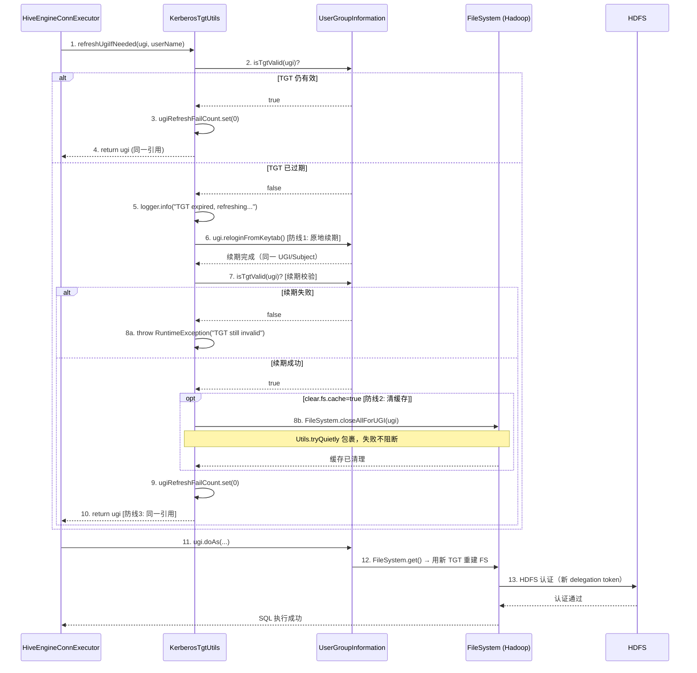
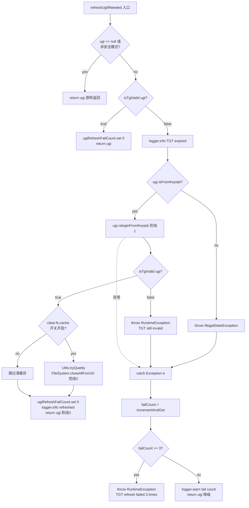

# 修复Hive引擎kerberos认证失败 - 设计文档

## 文档信息
- **文档版本**: v1.0
- **最后更新**: 2026-07-07
- **维护人**: v_kkhuang
- **文档状态**: 草稿
- **需求类型**: FIX（Bug 修复）
- **功能属性**: 后端
- **前端开发类型**: N/A
- **设计文档类型**: 单一设计文档
- **需求文档**: [修复Hive引擎kerberos认证失败_需求.md](../requirements/REQ-01_修复Hive引擎kerberos认证失败_需求.md)

---

## 执行摘要

> 阅读指引：本章节为1页概览（约500字），用于快速理解设计方案。详细内容请参考后续章节。

### 设计目标

| 目标 | 描述 | 优先级 |
|-----|------|-------|
| 根因修复 | 将 `refreshUgiIfNeeded` 从"换新 UGI"策略改为"原地续期 + 清缓存"，彻底解决 TGT 刷新成功但 HDFS 认证失败的问题 | P0 |
| 引用一致性 | 保持 UGI 对象引用不变，杜绝引用漂移导致的 FS 缓存绑定不一致 | P0 |
| 辅助开关可控 | 新增 FS 缓存清理/禁用开关，支持不同环境灵活调整 | P1 |
| 调用点零改动 | `HiveEngineConnExecutor` / `HiveEngineConcurrentConnExecutor` 调用点无需修改逻辑 | P1 |

### 核心设计决策

| 决策点 | 选择方案 | 决策理由（一句话） | 替代方案 |
|-------|---------|------------------|---------|
| 续期策略 | `ugi.reloginFromKeytab()` 原地续期 | 在同一 UGI/Subject 上重新 login，不换对象引用，杜绝引用漂移 | `loginUserFromKeytabAndReturnUGI` 换新 UGI（原始错误策略） |
| FS 缓存清理 | `FileSystem.closeAllForUGI(ugi)` | Hadoop 官方 API，清理旧 delegation token 缓存，确保后续 `FileSystem.get()` 用新 TGT 重建 | 手动遍历 Linkis `fileSystemCache`（无法清理 Hadoop 原生 FS 缓存） |
| 核心修复是否设新旧切换开关 | 不设开关，直接落地 | Bug 修复的本质是修正错误行为，原始"换新 UGI"策略本身是 Bug 而非"旧行为" | 新旧逻辑切换开关（增加复杂度，无实际收益） |
| 辅助特性开关 | `CommonVars[java.lang.Boolean]` 声明 | 清 FS 缓存有轻微性能开销，关 FS 缓存影响所有 HDFS 访问性能，需开关控制 | 硬编码始终开启（不够灵活） |

### 架构概览图

```
┌──────────────────────────────────────────────────────────────────┐
│                    Hive 引擎执行 SQL                              │
│                         │                                         │
│                         ▼                                         │
│   ┌─────────────────────────────────────┐                        │
│   │  refreshUgiIfNeeded(ugi, userName)   │                        │
│   │                                       │                        │
│   │  1. isTgtValid(ugi)? ── true ──→ return ugi (引用不变)        │
│   │       │ false                      │                        │
│   │       ▼                             │                        │
│   │  2. ugi.reloginFromKeytab()  ← 防线1: TGT层原地续期          │
│   │       │                             │                        │
│   │       ▼                             │                        │
│   │  3. isTgtValid(ugi)? ── false ──→ throw RuntimeException     │
│   │       │ true                        │                        │
│   │       ▼                             │                        │
│   │  4. FileSystem.closeAllForUGI(ugi) ← 防线2: 凭证层清缓存     │
│   │     (开关控制, tryQuietly包裹)      │                        │
│   │       │                             │                        │
│   │       ▼                             │                        │
│   │  5. return ugi  ← 防线3: 入口一致(同一对象引用)              │
│   │                                       │                        │
│   │  catch: failCount++ → <3 return ugi / >=3 throw              │
│   └─────────────────────────────────────┘                        │
│                         │                                         │
│                         ▼                                         │
│   ugi.doAs { FileSystem.get() → 用新 TGT 重建 FS → HDFS 认证通过 }│
└──────────────────────────────────────────────────────────────────┘
```

### 关键风险与缓解

| 风险 | 等级 | 缓解措施 |
|-----|------|---------|
| `reloginFromKeytab` 并发场景线程安全 | 中 | `HiveEngineConcurrentConnExecutor` 已有 `synchronized` + double-check 保护；`reloginFromKeytab` 内部有锁 |
| `reloginFromKeytab` 连续失败 | 中 | 失败计数降级：前2次返回原 UGI，第3次（MAX_REFRESH_FAILURES=3）抛 RuntimeException |
| `closeAllForUGI` 性能开销 | 低 | TGT 刷新低频（约每小时一次），重建 FS 开销可接受；开关可关闭 |
| Hadoop 版本兼容性 | 低 | `reloginFromKeytab` 和 `closeAllForUGI` 是 Hadoop 2.7+ 和 3.x 标准 API，双 profile 已验证 |

### 核心指标

| 指标 | 目标值 | 说明 |
|-----|-------|------|
| Hive 引擎持续可用时长 | > 24h | 突破当前 24h TGT 过期后认证失败的限制 |
| TGT 刷新后 HDFS 认证成功率 | 100% | 刷新成功即认证成功，杜绝"刷新成功但认证失败" |
| UGI 对象引用一致性 | `refreshedUgi == ugi` 恒为 true | 原地续期不换对象 |
| 非 Kerberos 环境影响 | 零 | `!isSecurityEnabled()` 时直接返回原 UGI |

### 章节导航

| 关注点 | 推荐章节 |
|-------|---------|
| 想了解改造前后对比 | [1.1 改造前后架构对比](#11-改造前后架构对比) |
| 想了解核心修复流程 | [1.2 核心修复流程设计](#12-核心修复流程设计) |
| 想了解改造后代码 | [1.3 改造后代码设计](#13-改造后代码设计) |
| 想了解配置开关设计 | [2.3 配置策略](#23-配置策略) |
| 想了解异常降级 | [1.4 异常处理与降级设计](#14-异常处理与降级设计) |
| 想了解测试方案 | [2.4 测试策略](#24-测试策略) |
| 想了解关联影响 | [2.6 关联影响分析](#26-关联影响分析) |
| 想查看完整代码 | [3.1 完整改造后代码](#31-完整改造后代码) |

---

# Part 1: 核心设计

> 本层目标：阐述改造前后对比、核心修复流程、改造后代码、异常降级，完整详细展开。
>
> 预计阅读时间：10-15分钟

## 1.1 改造前后架构对比

### 1.1.1 改造前现状（问题代码）

**当前 `KerberosTgtUtils.refreshUgiIfNeeded`（第129-165行）核心逻辑**：

```java
// ===== 问题代码（BEFORE）=====
public static UserGroupInformation refreshUgiIfNeeded(
    UserGroupInformation ugi, String userName) {
  if (ugi == null || !UserGroupInformation.isSecurityEnabled()) {
    return ugi;
  }
  if (isTgtValid(ugi)) {
    ugiRefreshFailCount.set(0);
    return ugi;
  }
  logger.info("TGT expired, refreshing UGI for user: {}", userName);
  try {
    // 问题：调用 HDFSUtils.getUserGroupInformation 创建全新 UGI 对象
    UserGroupInformation newUgi = HDFSUtils.getUserGroupInformation(userName);  // 第139行
    if (newUgi != null) {
      ugiRefreshFailCount.set(0);
      logger.info("UGI refreshed successfully for user: {}", userName);
      return newUgi;  // 返回新 UGI → 引用漂移
    } else {
      throw new RuntimeException("...returned null UGI");
    }
  } catch (Exception e) {
    int failCount = ugiRefreshFailCount.incrementAndGet();
    // ... 失败计数降级 ...
    return ugi;
  }
}
```

**三层不一致问题**：

| 层级 | 问题描述 | 后果 |
|-----|---------|------|
| UGI 引用漂移 | `loginUserFromKeytabAndReturnUGI` 创建全新 UGI 对象，executor 持有的引用被替换 | 新 UGI 的 TGT 有效，但旧引用可能被其他线程持有 |
| FS 缓存绑定不一致 | Hadoop FS 缓存按 UGI/Subject 维度管理，旧 FS 缓存实例仍绑定在旧 UGI 的 Subject 上 | 新 UGI 无法继承旧 FS 缓存中的 delegation token |
| delegation token 过期 | 旧 FS 缓存实例的 delegation token 是首次执行时用旧 TGT 换的，24h 后已过期 | `FileSystem.get()` 命中缓存 → 旧 token → HDFS 认证失败 |

### 1.1.2 改造后设计（三层防线）

| 防线 | 层级 | 机制 | 解决的问题 |
|:----:|------|------|-----------|
| 防线1 | TGT 层 | `ugi.reloginFromKeytab()` 原地续期（同一 UGI/Subject 上重新 login） | UGI 的 TGT 被原地刷新为有效状态 |
| 防线2 | 凭证层 | `FileSystem.closeAllForUGI(ugi)` 清理旧 delegation token 缓存（开关控制） | 旧 FS 缓存中的过期 delegation token 被清除，后续 `FileSystem.get()` 用新 TGT 重建 |
| 防线3 | 入口一致 | 原地刷新保持同一 UGI/Subject 对象，杜绝引用漂移 | executor 持有的 UGI 引用不变，Hadoop FS 缓存绑定一致 |

### 1.1.3 技术选型

| 层级 | 技术 | 版本 | 选型理由 |
|-----|------|------|---------|
| JDK | Java | 1.8 | 项目硬约束，禁用 Java 9+ 语法 |
| Hadoop UGI | `UserGroupInformation.reloginFromKeytab()` | 2.7.2 / 3.3.1 | Hadoop 官方原地续期标准 API，内部有锁，线程安全 |
| Hadoop FS | `FileSystem.closeAllForUGI(ugi)` | 2.7.2 / 3.3.1 | Hadoop 官方 API，清理指定 UGI 关联的所有 FS 缓存实例 |
| 配置 | `CommonVars[java.lang.Boolean]` | Linkis 既有 | 项目标准配置声明方式，与 `ENGINE_TGT_REFRESH_ENABLE` 一致 |

---

## 1.2 核心修复流程设计

### 1.2.1 TGT 原地续期与 FS 缓存清理时序图



#### 关键节点说明

| 节点 | 处理逻辑 | 输入/输出 | 异常处理 |
|-----|---------|----------|---------|
| 1. 请求 | Executor 执行 SQL 前调用 `refreshUgiIfNeeded` | 输入: `ugi` 对象 + `userName`<br>输出: UGI 对象（同一引用） | 总开关 `ENGINE_TGT_REFRESH_ENABLE=false` 时不调用 |
| 2. TGT 有效性检查 | `isTgtValid` 通过反射获取 Subject 中的 KerberosTicket，检查 `endTime` | 输入: UGI<br>输出: boolean | null/非安全模式返回 true（不阻断） |
| 6. 原地续期 | `ugi.reloginFromKeytab()` 在同一 UGI/Subject 上重新 login | 输入: UGI（内部含 keytab 信息）<br>输出: 同一 UGI 对象，TGT 已刷新 | 非 keytab UGI 抛 `IllegalStateException` |
| 7. 续期校验 | 再次调用 `isTgtValid` 验证续期是否真正成功 | 输入: UGI<br>输出: boolean | 续期后仍无效 → 抛 `RuntimeException` |
| 8b. 清 FS 缓存 | `FileSystem.closeAllForUGI(ugi)` 清理旧 delegation token | 输入: UGI<br>输出: 无 | `Utils.tryQuietly` 包裹，异常静默吞掉 |
| 10. 返回 | 返回同一 UGI 对象引用（ugi 变量未重新赋值） | 输出: `return ugi`（同一引用） | 调用点 `if (refreshedUgi != ugi)` 恒等 false |
| 8a/异常. 失败计数 | catch 块中 `ugiRefreshFailCount.incrementAndGet()` | 输入: 异常<br>输出: failCount | <3 返回原 UGI 降级；>=3 抛 RuntimeException |

#### 技术难点与解决方案

| 难点 | 问题描述 | 解决方案 | 决策理由 |
|-----|---------|---------|---------|
| UGI 引用漂移 | 原始实现 `loginUserFromKeytabAndReturnUGI` 创建新 UGI，导致 executor 持有的引用被替换，旧 FS 缓存绑定在旧 Subject 上 | 改用 `reloginFromKeytab` 原地续期，同一 UGI/Subject 上重新 login | Hadoop 官方标准原地续期方法，不换对象引用，从根源杜绝引用漂移 |
| FS 缓存 delegation token 过期 | `FileSystem.get()` 命中 Hadoop FS 缓存中的旧 FS 实例，其 delegation token 是旧 TGT 换的 | 续期后调用 `FileSystem.closeAllForUGI(ugi)` 清理缓存 | Hadoop 官方 API，按 UGI 维度清理所有关联 FS 缓存实例，确保下次 `get()` 用新 TGT 重建 |
| 并发场景线程安全 | `HiveEngineConcurrentConnExecutor` 多线程并发调用 `refreshUgiIfNeeded` | 原地续期不换 UGI 引用，`reloginFromKeytab` 内部有锁，调用点已有 `synchronized` + double-check | 不换引用 → 不会出现"多线程拿到不同 UGI"；Hadoop 内部锁 → 续期操作原子 |
| `closeAllForUGI` 失败阻断 | `closeAllForUGI` 可能因 FS 关闭异常失败 | `Utils.tryQuietly` 包裹，静默吞掉异常 | 防线2是辅助操作，防线1（TGT 续期）已确保 TGT 有效；清缓存失败时下次 `isTgtValid` 仍 false → 再次尝试续期 |

#### 边界与约束

- **前置条件**：`linkis.engineconn.tgt.refresh.enable=true`（总开关已开启）；Kerberos 认证环境（`UserGroupInformation.isSecurityEnabled()=true`）；UGI 是 keytab-based（`ugi.isFromKeytab()=true`）
- **后置保证**：返回的 UGI 对象引用与传入的相同（`refreshedUgi == ugi`）；TGT 已刷新为有效状态；FS 缓存已清理（开关开启时）
- **并发约束**：`HiveEngineConcurrentConnExecutor` 调用点已有 `synchronized` + double-check 保护；`reloginFromKeytab` 是 Hadoop 官方线程安全方法
- **性能约束**：TGT 刷新低频（约每小时一次，受 KDC `ticket_lifetime` 控制）；`closeAllForUGI` 后重建 FS 的开销在毫秒级，可接受

---

## 1.3 改造后代码设计

### 1.3.1 改造后 `refreshUgiIfNeeded` 方法（片段对比）

以下为关键修复点的 Before/After 代码对比（完整实现见 [3.1 完整改造后代码](#31-完整改造后代码)）：

```java
// ===== 问题代码（BEFORE）- 第139行核心 =====
UserGroupInformation newUgi = HDFSUtils.getUserGroupInformation(userName);
if (newUgi != null) {
    ugiRefreshFailCount.set(0);
    return newUgi;  // ← 返回新 UGI，引用漂移
}

// ===== 修复代码（AFTER）- 防线1+2+3 =====
// 防线1：TGT层 - 原地续期（同一 UGI/Subject 上重新 login）
if (ugi.isFromKeytab()) {
    ugi.reloginFromKeytab();
} else {
    throw new IllegalStateException("UGI is not keytab-based, cannot relogin");
}

// 续期校验
if (!isTgtValid(ugi)) {
    throw new RuntimeException("TGT still invalid after relogin");
}

// 防线2：凭证层 - 清理旧 delegation token 缓存（开关控制, tryQuietly包裹）
if (HadoopConf.ENGINE_TGT_REFRESH_CLEAR_FS_CACHE) {
    Utils.tryQuietly(FileSystem.closeAllForUGI(ugi));
    logger.info("HDFS FS cache cleared for user: {}", userName);
}

// 防线3：入口一致 - 返回同一对象引用（ugi 变量未重新赋值）
ugiRefreshFailCount.set(0);
return ugi;  // ← 同一对象引用
```

### 1.3.2 配置开关设计（HadoopConf.scala 新增）

在 `HadoopConf.scala` 的 `ENGINE_TGT_REFRESH_ENABLE`（第101行）后追加两个开关：

```scala
// 新增配置项（片段，完整代码见 3.1）
val ENGINE_TGT_REFRESH_CLEAR_FS_CACHE =
  CommonVars[java.lang.Boolean](
    "linkis.engineconn.tgt.refresh.clear.fs.cache", true).getValue

val ENGINE_TGT_REFRESH_DISABLE_FS_CACHE =
  CommonVars[java.lang.Boolean](
    "linkis.engineconn.tgt.refresh.disable.fs.cache", false).getValue
```

### 1.3.3 调用点兼容性设计

| 调用点文件 | 行号 | 改造前逻辑 | 改造后行为 | 是否需要改动 |
|-----------|------|-----------|-----------|:----------:|
| `HiveEngineConnExecutor.scala` | 226-231 | `if (refreshedUgi != ugi) { ugi = refreshedUgi }` | `refreshedUgi == ugi` 恒等 true → `if` 条件恒为 false → 不执行赋值 | 否 |
| `HiveEngineConcurrentConnExecutor.scala` | 187-197 | `synchronized` + double-check + `if (refreshedUgi != ugi)` | 同上，`if` 条件恒为 false | 否 |

**兼容性保证**：改造后 `refreshUgiIfNeeded` 始终返回传入的同一 UGI 对象引用，调用点的 `if (refreshedUgi != ugi)` 判定自动恒等为 false，不触发引用替换。两个调用点无需修改任何逻辑。

### 1.3.4 核心业务规则

| 规则编号 | 规则描述 | 触发条件 | 处理逻辑 |
|---------|---------|---------|---------|
| BR-001 | 非 Kerberos 环境直接返回 | `!UserGroupInformation.isSecurityEnabled()` | 返回原 UGI，无任何副作用 |
| BR-002 | TGT 有效时重置失败计数 | `isTgtValid(ugi) == true` | `ugiRefreshFailCount.set(0)`，返回原 UGI |
| BR-003 | 非 keytab UGI 不可续期 | `ugi.isFromKeytab() == false` | 抛 `IllegalStateException`（被外层 catch 捕获，走失败计数降级） |
| BR-004 | 续期后 TGT 仍无效则报错 | `isTgtValid(ugi) == false`（relogin 后） | 抛 `RuntimeException`（被外层 catch 捕获，走失败计数降级） |
| BR-005 | FS 缓存清理开关控制 | `ENGINE_TGT_REFRESH_CLEAR_FS_CACHE == true` | 调用 `FileSystem.closeAllForUGI(ugi)`；关闭时不调用 |
| BR-006 | 失败计数降级 | `reloginFromKeytab` 抛异常 | `failCount++`；`<3` 返回原 UGI；`>=3` 抛 RuntimeException |

---

## 1.4 异常处理与降级设计

### 1.4.1 异常降级流程



### 1.4.2 异常处理策略表

| 异常类型 | 来源 | 检测条件 | 处理策略 | 对外行为 |
|---------|------|---------|---------|---------|
| `IllegalStateException` | `ugi.isFromKeytab()=false` | 非 keytab UGI 不可续期 | 走 catch → 失败计数 | <3: 返回原 UGI 降级；>=3: 抛 RuntimeException |
| `RuntimeException`（续期后 TGT 仍无效） | `isTgtValid(ugi)=false` after relogin | relogin 未真正刷新 TGT | 走 catch → 失败计数 | 同上 |
| `reloginFromKeytab` 内部异常 | keytab 文件丢失/KDC 不可用 | relogin 抛 IOException 等 | 走 catch → 失败计数 | 同上 |
| `FileSystem.closeAllForUGI` 异常 | FS 关闭失败 | closeAllForUGI 抛异常 | `Utils.tryQuietly` 静默吞掉 | 不影响主流程，继续返回 ugi |
| 总开关关闭 | `ENGINE_TGT_REFRESH_ENABLE=false` | 调用点不调用 | 无 | 现状行为（不刷新） |

### 1.4.3 降级语义说明

| 降级层级 | 触发条件 | 行为 | 风险 |
|---------|---------|------|------|
| 全关闭降级 | `enable=false` | `refreshUgiIfNeeded` 不被调用 | 无 TGT 刷新（现状行为） |
| 清缓存关闭降级 | `enable=true, clear.fs.cache=false` | 仅防线1（TGT 续期），不清 FS 缓存 | delegation token 可能仍过期（仅依赖 HDFS 主动检查兜底） |
| 续期失败降级 | `reloginFromKeytab` 抛异常, `failCount < 3` | 返回原 UGI（TGT 可能已过期） | 本次 SQL 可能 HDFS 认证失败，但引擎不崩溃 |
| 续期失败报错 | `failCount >= 3` | 抛 RuntimeException | 引擎报错退出，等待 ECM 重新拉起 |

---

## 1.5 设计决策记录 (ADR)

### ADR-001: 续期策略选择 — reloginFromKeytab vs loginUserFromKeytabAndReturnUGI

- **状态**：已采纳
- **背景**：原始实现使用 `loginUserFromKeytabAndReturnUGI` 创建新 UGI 对象替换引用，导致三层不一致
- **决策**：改用 `ugi.reloginFromKeytab()` 原地续期
- **选项对比**：

| 选项 | 优点 | 缺点 | 适用场景 |
|-----|------|------|---------|
| `loginUserFromKeytabAndReturnUGI`（原始） | 获得全新 UGI，TGT 全新 | 引用漂移 + FS 缓存不一致 + delegation token 过期 | 不适用（本 Bug 的根因） |
| `reloginFromKeytab`（采纳） | 同一 UGI/Subject 原地续期，引用不变，FS 缓存绑定一致 | 需要 UGI 是 keytab-based | keytab 认证的 Hive 引擎（本场景） |
| `checkTGTAndReloginFromKeytab` | 内部含 TGT 检查 + 续期 | 与已有 `isTgtValid` 检查重复 | JDBC/HBase 路径（`refreshLoginUserTgtIfNeeded` 已用） |

- **结论**：`reloginFromKeytab` 是 Hadoop UGI 原地续期的标准方法，在同一 UGI/Subject 上重新 login，不换对象引用。与已有 `isTgtValid` 前置检查配合，逻辑更简洁可控
- **影响**：`refreshUgiIfNeeded` 返回值语义从"可能返回新 UGI"变为"始终返回同一 UGI"，调用点 `if (refreshedUgi != ugi)` 自动兼容

### ADR-002: FS 缓存清理方式 — closeAllForUGI vs 手动遍历 fileSystemCache

- **状态**：已采纳
- **背景**：续期后旧 FS 缓存中的 delegation token 仍过期，需清理
- **决策**：使用 `FileSystem.closeAllForUGI(ugi)`（Hadoop 官方 API）
- **选项对比**：

| 选项 | 优点 | 缺点 | 适用场景 |
|-----|------|------|---------|
| `FileSystem.closeAllForUGI(ugi)`（采纳） | Hadoop 官方 API，按 UGI 维度清理所有关联 FS 缓存实例 | 关闭后下次 `FileSystem.get()` 需重建 FS（毫秒级开销） | Hive 引擎访问 HDFS 走 Hadoop 原生 `FileSystem.get()` |
| 手动遍历 Linkis `fileSystemCache` | 可精确控制 Linkis 层缓存 | 无法清理 Hadoop 原生 FS 缓存（Hive 引擎走的是 Hadoop 原生 API） | 不适用（清理不到正确的缓存层） |

- **结论**：Hive 引擎执行时走 Hadoop 原生 `FileSystem.get()`，其缓存由 Hadoop 框架管理，必须用 Hadoop 官方 API 清理
- **影响**：新增 `ENGINE_TGT_REFRESH_CLEAR_FS_CACHE` 开关控制此操作，默认 true

### ADR-003: 核心修复不设新旧逻辑切换开关

- **状态**：已采纳
- **背景**：CLAUDE.md 铁律要求新功能加开关默认关闭。但本需求是 Bug 修复（FIX 类型）
- **决策**：核心修复（原地续期）直接落地，不设新旧逻辑切换开关。辅助特性（清 FS 缓存/关 FS 缓存）用开关控制
- **理由**：原始"换新 UGI"策略本身就是错误的——它不是"旧行为"，而是"有 Bug 的行为"。Bug 修复的本质就是修正错误行为。已有总开关 `linkis.engineconn.tgt.refresh.enable`（默认 false）控制整个 TGT 懒刷新逻辑的启停，关闭时 `refreshUgiIfNeeded` 不被调用，等效于回滚
- **影响**：开关全关闭时（`enable=false`），行为与修复前一致（不刷新 TGT）

---

# Part 2: 支撑设计

> 本层目标：配置策略、测试策略、关联影响、监控与告警的结构化摘要。
>
> 预计阅读时间：5-10分钟

## 2.1 数据模型设计

本需求不涉及数据库表结构变更，无新增表/字段。

## 2.2 API规范设计

本需求不涉及 RESTful API 变更，无新增/修改接口端点。

---

## 2.3 配置策略

### 2.3.1 关键配置项

| 配置项 | 默认值 | 说明 | 调整建议 |
|-------|-------|------|---------|
| `linkis.engineconn.tgt.refresh.enable` | `false` | 引擎 TGT 懒刷新总开关（已有，复用） | Kerberos 环境建议开启 |
| `linkis.engineconn.tgt.refresh.clear.fs.cache` | `true` | **新增**。原地续期后是否清理 HDFS FS 缓存 | 性能敏感环境可关闭（仅依赖 TGT 层续期） |
| `linkis.engineconn.tgt.refresh.disable.fs.cache` | `false` | **新增**。是否完全禁用 HDFS FS 缓存 | 仅极端场景兜底，开启后性能下降 |
| `linkis.hadoop.hdfs.tgt.proactive.check.enable` | `true` | HDFS 缓存层主动 TGT 检查（已有，互补） | 与引擎层懒刷新互补，建议保持开启 |

### 2.3.2 开关决策矩阵

| 开关组合 | TGT 续期 | 清 FS 缓存 | 禁用 FS 缓存 | 适用场景 |
|---------|:--------:|:----------:|:------------:|---------|
| enable=false | 不触发 | - | - | 非 Kerberos 环境，或不需要引擎层 TGT 刷新 |
| enable=true, clear=true, disable=false | 原地续期 | 是 | 否 | **推荐配置**：Kerberos 环境，三层防线全开 |
| enable=true, clear=false, disable=false | 原地续期 | 否 | 否 | 性能敏感环境，仅依赖 TGT 层续期 |
| enable=true, clear=true, disable=true | 原地续期 | 是 | 是 | 极端兜底：彻底禁用 FS 缓存，每次重建 |

### 2.3.3 环境差异配置

| 配置项 | 开发环境 | 测试环境(SIT) | 生产环境 |
|-------|---------|-------------|---------|
| `tgt.refresh.enable` | false | true | true（灰度后） |
| `tgt.refresh.clear.fs.cache` | true | true | true |
| `tgt.refresh.disable.fs.cache` | false | false | false |

---

## 2.4 测试策略

### 2.4.1 测试范围

| 测试类型 | 覆盖范围 | 优先级 |
|---------|---------|-------|
| 单元测试 | `KerberosTgtUtils.refreshUgiIfNeeded` 4 场景 + 配置开关读取 | P0 |
| 集成测试 | Kerberos 环境 SIT >= 24h 持续验证 | P0 |
| 回归测试 | 非 Kerberos 环境 + JDBC 引擎 + HBase 引擎 | P0 |

### 2.4.2 关键测试场景

| 场景 | 输入 | 预期输出 | 优先级 |
|-----|------|---------|-------|
| UT-1: TGT 有效不刷新 | `isTgtValid=true` | 返回原 UGI，`ugiRefreshFailCount=0`，不调用 relogin | P0 |
| UT-2: 原地续期成功 | `isTgtValid=false` → relogin 成功 → `isTgtValid=true` | 返回同一 UGI 引用，`ugiRefreshFailCount=0`，调用 `closeAllForUGI` | P0 |
| UT-3: 续期失败计数降级 | relogin 抛异常，failCount=1,2 | 返回原 UGI 降级，warn 日志 | P0 |
| UT-4: 达上限抛异常 | relogin 抛异常，failCount=3 | 抛 RuntimeException | P0 |
| UT-5: 清缓存开关关闭 | `clear.fs.cache=false` | 不调用 `closeAllForUGI`，其余正常 | P1 |
| IT-1: Kerberos 24h 长运行 | 引擎存活 > 24h，TGT 过期后执行 SQL | SQL 正常执行，HDFS 认证通过 | P0 |
| IT-2: 并发场景 | `HiveEngineConcurrentConnExecutor` 多线程并发 | 无引用漂移，无重复刷新 | P1 |
| RT-1: 非 Kerberos 回归 | 非 Kerberos 环境执行 Hive SQL | `refreshUgiIfNeeded` 直接返回原 UGI | P0 |
| RT-2: JDBC 引擎回归 | Kerberos 环境 JDBC 引擎 SQL | 走 `refreshLoginUserTgtIfNeeded`，不受影响 | P0 |
| RT-3: HBase 引擎回归 | Kerberos 环境 HBase 引擎 SQL | 走 `refreshLoginUserTgtIfNeeded`，不受影响 | P0 |

### 2.4.3 验证清单

| 验证项 | 验证方法 | 通过标准 |
|-------|---------|---------|
| UGI 引用一致性 | `Assert.assertTrue(refreshedUgi == ugi)` | 恒为 true |
| TGT 续期成功 | `Assert.assertTrue(isTgtValid(refreshedUgi))` | 续期后为 true |
| 失败计数重置 | TGT 有效时调用后检查 `ugiRefreshFailCount==0` | 为 0 |
| 非 Kerberos 零影响 | 非 Kerberos 环境调用前后 UGI 对象相同 | 引用不变 |
| 日志输出 | 检查日志包含 "TGT expired, refreshing UGI in-place" | 关键日志存在 |

---

## 2.5 外部依赖接口设计

本需求不涉及外部系统或第三方服务调用变更，无新增外部依赖。

---

## 2.6 关联影响分析

### 2.6.1 高危区域对照（CLAUDE.md 10.2）

本需求触及 `linkis-commons/linkis-hadoop-common` 中的 Kerberos 工具类，属于**公共服务工具类**，**不触及** 10.2 中列出的 10 个任务执行主线高危环节。

| 10.2 高危环节 | 是否触及 | 说明 |
|---------------|:--------:|------|
| #1 任务主入口 `EntranceServer.execute()` | 否 | 不修改 |
| #2 拦截器链 | 否 | 不修改拦截器链顺序 |
| #3 引擎新建 `DefaultEngineCreateService` | 否 | 不修改 |
| #4 引擎复用 `DefaultEngineReuseService` | 否 | 不修改 |
| #5 EC 接任务 `TaskExecutionServiceImpl` | 否 | 不修改 |
| #6 回调 Entrance `sendToEntrance()` | 否 | 不修改 |
| #7 任务持久化 `PersistenceManager` | 否 | 不修改 |
| #8 LM 刷新物料 `DefaultEngineConnResourceService` | 否 | 不修改 |
| #9 ECM 拉物料 `BmlResourceLocalizationService` | 否 | 不修改 |
| #10 脚本组装 `JavaProcessEngineConnLaunchBuilder` | 否 | 不修改 |

### 2.6.2 影响清单

| 维度 | 影响 |
|------|------|
| 功能模块 | `linkis-commons/linkis-hadoop-common`（KerberosTgtUtils + HadoopConf）、`linkis-engineconn-plugins/hive`（调用点兼容验证） |
| API 契约 | `refreshUgiIfNeeded` 方法签名不变，返回值语义从"可能返回新 UGI"变为"始终返回同一 UGI"，调用点自动兼容 |
| 前端 | 不涉及前端改动 |
| 上下游依赖 | Hive 引擎上游（Entrance/Orchestrator）和下游（HDFS/Hive Metastore）不受影响 |
| 配置 | 新增 2 个配置项，需在部署配置文件补充注释行 |
| 兼容性 | 非 Kerberos 环境直接返回原 UGI；JDBC/HBase 走独立方法不受影响 |
| 提示词注入风险 | N/A（Java/Scala 后端 Bug 修复，不涉及 Claude 插件开发） |

### 2.6.3 复用决策表

| 现有资产 | 复用/扩展/新建 | 理由 |
|---------|:-------------:|------|
| `KerberosTgtUtils.refreshUgiIfNeeded` | 扩展（改造方法体） | 核心修复目标，方法签名不变 |
| `KerberosTgtUtils.isTgtValid` | 复用 | TGT 有效性检查逻辑不改动 |
| `KerberosTgtUtils.ugiRefreshFailCount` | 复用 | 已有失败计数器，复用 |
| `KerberosTgtUtils.MAX_REFRESH_FAILURES` | 复用 | 已有常量 `=3`，复用 |
| `KerberosTgtUtils.getSubjectFromUgi` | 复用 | 反射获取 Subject，不改动 |
| `HadoopConf.ENGINE_TGT_REFRESH_ENABLE` | 复用 | 已有总开关，复用 |
| `HadoopConf` | 扩展（新增2个配置项） | 在现有配置对象中追加开关 |
| `HDFSUtils.getUserGroupInformation` | 不再调用 | 改造后 `refreshUgiIfNeeded` 不再调用此方法创建新 UGI（方法本身保留，初始化时仍用） |
| `HiveEngineConnExecutor` 调用点 | 复用（无需改动） | 返回同一引用，`if (refreshedUgi != ugi)` 自动兼容 |
| `HiveEngineConcurrentConnExecutor` 调用点 | 复用（无需改动） | 同上，`synchronized` + double-check 已就绪 |

---

## 2.7 监控与告警

### 2.7.1 关键指标

| 指标 | 阈值 | 告警级别 | 说明 |
|-----|------|---------|------|
| TGT 刷新成功次数 | - | P2(info) | 日志关键词："UGI refreshed in-place" |
| TGT 刷新失败次数 | >= 1 | P1(warn) | 日志关键词："Failed to refresh UGI" |
| TGT 刷新连续失败达上限 | >= 1 | P0(error) | 日志关键词："TGT refresh failed 3 times" |
| HDFS 认证失败次数 | > 0 | P0 | 验证修复后应降为零 |
| Hive 引擎存活时长 | < 24h | P1 | 验证是否突破 24h 限制 |
| `closeAllForUGI` 调用频率 | - | P2(info) | 应约每小时一次（TGT 刷新频率） |

---

## 2.8 风险与回滚

### 2.8.1 风险识别

| 风险 | 等级 | 说明与缓解 |
|------|:----:|-----------|
| `reloginFromKeytab` 并发场景线程安全 | 中 | `HiveEngineConcurrentConnExecutor` 已有 `synchronized` + double-check 保护；`reloginFromKeytab` 内部有锁。缓解：并发场景充分测试 |
| `closeAllForUGI` 性能开销 | 低 | TGT 刷新低频（约每小时一次），重建 FS 开销毫秒级。缓解：开关可关闭 |
| `reloginFromKeytab` 连续失败 | 中 | keytab 丢失/KDC 不可用。缓解：失败计数降级——前2次返回原 UGI，第3次报错 |
| Hadoop 版本兼容性 | 低 | `relinkFromKeytab` 和 `closeAllForUGI` 是 2.7+ 和 3.x 标准 API，双 profile 已验证 |
| 影响非 Hive 引擎 | 低 | 仅改 `refreshUgiIfNeeded`（Hive 路径），JDBC/HBase 走 `refreshLoginUserTgtIfNeeded` |

### 2.8.2 回滚方案

| 回滚层级 | 触发条件 | 操作步骤 | 回滚时间 |
|---------|---------|---------|---------|
| L1: 关闭总开关 | 修复后仍出现 HDFS 认证失败 | 设置 `linkis.engineconn.tgt.refresh.enable=false` + 重启 Hive 引擎 | 约5分钟 |
| L2: 关闭清缓存 | `closeAllForUGI` 导致问题 | 设置 `linkis.engineconn.tgt.refresh.clear.fs.cache=false` + 重启 | 约5分钟 |
| L3: 代码回滚 | 核心修复本身有问题 | git revert 改造 commit，恢复原始 `refreshUgiIfNeeded` | 需重新发版 |

**回滚验证点**：
- 关闭 `enable` 后，`refreshUgiIfNeeded` 不被调用，行为回退到修复前
- 新引擎启动后的首次 UGI 初始化不受影响（`HDFSUtils.getUserGroupInformation` 在初始化时仍正常调用）

### 2.8.3 发布策略

1. **SIT 环境先行**：Kerberos 认证测试环境设置 `enable=true`，验证引擎存活 > 24h 后 SQL 正常
2. **生产灰度**：`enable=true` + `clear.fs.cache=true` + `disable.fs.cache=false`（推荐配置），观察 48 小时
3. **监控指标**：TGT 刷新成功/失败次数、HDFS 认证失败次数、Hive 引擎存活时长

---

# Part 3: 参考资料

> 本层目标：完整改造后代码、配置文件示例，按需查阅。
>
> 使用方式：点击展开查看详细内容

## 3.1 完整改造后代码

<details>
<summary>KerberosTgtUtils.java - refreshUgiIfNeeded 改造后完整方法</summary>

```java
/*
 * Licensed to the Apache Software Foundation (ASF) under one or more
 * contributor license agreements.  See the NOTICE file distributed with
 * this work for additional information regarding copyright ownership.
 * The ASF licenses this file to You under the Apache License, Version 2.0
 * (the "License"); you may not use this file except in compliance with
 * the License.  You may obtain a copy of the License at
 *
 *   http://www.apache.org/licenses/LICENSE-2.0
 *
 * Unless required by applicable law or agreed to in writing, software
 * distributed under the License is distributed on an "AS IS" BASIS,
 * WITHOUT WARRANTIES OR CONDITIONS OF ANY KIND, either express or implied.
 * See the License for the specific language governing permissions and
 * limitations under the License.
 */

package org.apache.linkis.hadoop.common.utils;

import org.apache.hadoop.security.UserGroupInformation;
import org.apache.linkis.hadoop.common.conf.HadoopConf;
import org.apache.linkis.hadoop.common.utils.HDFSUtils;
import org.apache.linkis.common.utils.Utils;

import javax.security.auth.Subject;
import javax.security.auth.kerberos.KerberosTicket;
import java.lang.reflect.Method;
import java.util.Set;
import java.util.concurrent.atomic.AtomicBoolean;
import java.util.concurrent.atomic.AtomicInteger;
import java.util.concurrent.atomic.AtomicReference;
import org.apache.hadoop.fs.FileSystem;
import org.slf4j.Logger;
import org.slf4j.LoggerFactory;

public class KerberosTgtUtils {

  private static final Logger logger = LoggerFactory.getLogger(KerberosTgtUtils.class);

  private static final AtomicReference<Method> getSubjectMethod = new AtomicReference<>();
  private static final AtomicBoolean getSubjectMethodResolved = new AtomicBoolean(false);

  /** Maximum consecutive refresh failures before throwing an error. */
  private static final int MAX_REFRESH_FAILURES = 3;

  /** Consecutive refresh failure counter for UGI refresh (Hive path). */
  private static final AtomicInteger ugiRefreshFailCount = new AtomicInteger(0);

  /** Consecutive refresh failure counter for login user TGT refresh (JDBC/HBase path). */
  private static final AtomicInteger loginUserRefreshFailCount = new AtomicInteger(0);

  // ... getSubjectFromUgi / isTgtValid methods unchanged ...

  /**
   * Refresh UGI TGT in-place if needed (Hive engine path).
   *
   * Three-layer defense strategy:
   *   Defense 1 (TGT layer): ugi.reloginFromKeytab() in-place relogin on same UGI/Subject
   *   Defense 2 (Credential layer): FileSystem.closeAllForUGI(ugi) clear stale delegation tokens
   *   Defense 3 (Entry consistency): return same UGI object reference (no reference drift)
   *
   * Failure degradation:
   *   reloginFromKeytab exception -> failCount++ -> <MAX return original UGI / >=MAX throw
   *
   * @param ugi the UserGroupInformation to check/refresh
   * @param userName the user name for logging
   * @return the same UGI object (reference unchanged), with TGT refreshed if was expired
   * @throws RuntimeException if refresh failed consecutively MAX_REFRESH_FAILURES times
   */
  public static UserGroupInformation refreshUgiIfNeeded(
      UserGroupInformation ugi, String userName) {
    // Input validation: null or non-kerberos mode → return as-is
    if (ugi == null || !UserGroupInformation.isSecurityEnabled()) {
      return ugi;
    }

    // TGT still valid → reset fail count, return original UGI
    if (isTgtValid(ugi)) {
      ugiRefreshFailCount.set(0);
      return ugi;
    }

    logger.info("TGT expired, refreshing UGI in-place for user: {}", userName);
    try {
      // Defense 1: TGT layer - in-place relogin on same UGI/Subject
      if (ugi.isFromKeytab()) {
        ugi.reloginFromKeytab();
      } else {
        throw new IllegalStateException(
            "UGI is not keytab-based, cannot relogin for user: " + userName);
      }

      // Verify relogin succeeded
      if (!isTgtValid(ugi)) {
        throw new RuntimeException(
            "TGT still invalid after reloginFromKeytab for user: " + userName);
      }

      // Defense 2: Credential layer - clear stale delegation token cache (switch-controlled)
      if (HadoopConf.ENGINE_TGT_REFRESH_CLEAR_FS_CACHE) {
        Utils.tryQuietly(
            new org.apache.linkis.common.utils.Utils.Function0<Unit>() {
              @Override
              public Unit apply() {
                FileSystem.closeAllForUGI(ugi);
                return null;
              }
            });
        logger.info("HDFS FS cache cleared for user: {}", userName);
      }

      // Defense 3: Entry consistency - return same object reference (ugi not reassigned)
      ugiRefreshFailCount.set(0);
      logger.info("UGI refreshed in-place for user: {}", userName);
      return ugi;  // same object reference

    } catch (Exception e) {
      // Failure counting degradation: <MAX return original UGI, >=MAX throw
      int failCount = ugiRefreshFailCount.incrementAndGet();
      logger.warn(
          "Failed to refresh UGI in-place for user: {}, consecutive failure count: {}",
          userName,
          failCount,
          e);
      if (failCount >= MAX_REFRESH_FAILURES) {
        throw new RuntimeException(
            "TGT refresh has failed consecutively for "
                + MAX_REFRESH_FAILURES
                + " times (user: "
                + userName
                + "). Please check keytab file, Kerberos configuration and KDC availability.",
            e);
      }
      return ugi;  // degradation: return original UGI
    }
  }

  // ... refreshLoginUserTgtIfNeeded method unchanged ...
}
```

> 注意：上述代码中 `Utils.tryQuietly` 的调用方式需根据 Linkis 项目的 `Utils` 工具类实际签名调整。Java 中调用 Scala 的 `Utils.tryQuietly` 需注意泛型与函数接口适配。如果 `Utils.tryQuietly` 在 Java 侧不可直接调用，可改用标准 try-catch 静默吞掉异常的等价写法：
>
> ```java
> // Java 等价写法（如果 Utils.tryQuietly 不便在 Java 调用）
> if (HadoopConf.ENGINE_TGT_REFRESH_CLEAR_FS_CACHE) {
>   try {
>     FileSystem.closeAllForUGI(ugi);
>     logger.info("HDFS FS cache cleared for user: {}", userName);
>   } catch (Exception cacheEx) {
>     logger.warn("Failed to clear HDFS FS cache for user: {}, non-blocking: {}",
>         userName, cacheEx.getMessage());
>   }
> }
> ```

</details>

<details>
<summary>HadoopConf.scala - 新增配置开关</summary>

```scala
/*
 * Licensed to the Apache Software Foundation (ASF) under one or more
 * contributor license agreements.  See the NOTICE file distributed with
 * this work for additional information regarding copyright ownership.
 * The ASF licenses this file to You under the Apache License, Version 2.0
 * (the "License"); you may not use this file except in compliance with
 * the License.  You may obtain a copy of the License at
 *
 *   http://www.apache.org/licenses/LICENSE-2.0
 *
 * Unless required by applicable law or agreed to in writing, software
 * distributed under the License is distributed on an "AS IS" BASIS,
 * WITHOUT WARRANTIES OR CONDITIONS OF ANY KIND, either express or implied.
 * See the License for the specific language governing permissions and
 * limitations under the License.
 */

package org.apache.linkis.hadoop.common.conf

import org.apache.linkis.common.conf.{CommonVars, TimeType}

object HadoopConf {

  // ... existing configs (lines 24-101) unchanged ...

  /**
   * 引擎TGT懒刷新公共开关。开启后，Hive/JDBC/HBase引擎在执行任务前检查TGT有效性，过期则自动刷新。
   *   - Hive: executeLine前检查持有的UGI对象TGT，过期则原地续期
   *   - JDBC: getConnection前检查JVM全局loginUser的TGT，过期则重新login
   *   - HBase: getConnection前检查JVM全局loginUser的TGT，过期则重新login
   * 适用场景：开启Kerberos认证且未开启HDFS缓存的长时间运行引擎。
   *   默认关闭，需显式开启。
   */
  val ENGINE_TGT_REFRESH_ENABLE =
    CommonVars[java.lang.Boolean]("linkis.engineconn.tgt.refresh.enable", false).getValue

  /**
   * TGT刷新后清理HDFS FS缓存开关（防线2辅助开关）。
   * 开启：原地续期后调用 FileSystem.closeAllForUGI(ugi) 清理旧 delegation token 缓存，
   *       确保后续 FileSystem.get() 用新TGT重建FS。
   * 关闭：仅依赖防线1（TGT层原地续期），不清缓存（性能略优但可能残留过期token）。
   * 默认开启，Kerberos环境推荐保持开启。
   */
  val ENGINE_TGT_REFRESH_CLEAR_FS_CACHE =
    CommonVars[java.lang.Boolean](
      "linkis.engineconn.tgt.refresh.clear.fs.cache", true).getValue

  /**
   * 禁用HDFS FS缓存开关（极端场景兜底）。
   * 开启：每次HDFS访问创建新FS实例（fs.hdfs.impl.disable.cache=true），彻底避免缓存不一致，
   *       但性能下降显著。
   * 关闭：正常使用Hadoop FS缓存。
   * 默认关闭，仅极端场景兜底使用。
   */
  val ENGINE_TGT_REFRESH_DISABLE_FS_CACHE =
    CommonVars[java.lang.Boolean](
      "linkis.engineconn.tgt.refresh.disable.fs.cache", false).getValue

}
```

</details>

<details>
<summary>调用点代码 - 验证兼容（无需改动）</summary>

**HiveEngineConnExecutor.scala 第226-231行（不改动）**：
```scala
// TGT懒刷新：开关开启时检查TGT有效性，过期则原地续期
// 工具方法内部前2次失败降级用原UGI，连续3次失败抛异常报错
// 改造后：refreshUgiIfNeeded 始终返回同一 UGI 引用，if 条件恒为 false
if (HadoopConf.ENGINE_TGT_REFRESH_ENABLE) {
  val refreshedUgi = KerberosTgtUtils.refreshUgiIfNeeded(ugi, Utils.getJvmUser)
  if (refreshedUgi != ugi) {  // 改造后恒为 false，不执行赋值
    ugi = refreshedUgi
  }
}
```

**HiveEngineConcurrentConnExecutor.scala 第187-197行（不改动）**：
```scala
// TGT懒刷新：开关开启时检查TGT有效性，过期则原地续期（含同步锁保护）
// 改造后：refreshUgiIfNeeded 始终返回同一 UGI 引用，if 条件恒为 false
if (HadoopConf.ENGINE_TGT_REFRESH_ENABLE) {
  if (!KerberosTgtUtils.isTgtValid(ugi)) {
    logger.info("TGT expired, refreshing UGI for HiveEngineConcurrentConnExecutor")
    synchronized {
      // double-check：防止多线程同时刷新
      val refreshedUgi = KerberosTgtUtils.refreshUgiIfNeeded(ugi, Utils.getJvmUser)
      if (refreshedUgi != ugi) {  // 改造后恒为 false，不执行赋值
        ugi = refreshedUgi
      }
    }
  }
}
```

</details>

---

## 3.2 配置文件示例

<details>
<summary>部署配置文件注释行 - linkis-dist/package/conf/</summary>

```properties
# ==============================================================================
# 引擎 TGT 懒刷新与 FS 缓存配置
# ==============================================================================

# 引擎TGT懒刷新总开关（默认关闭）
# 开启后 Hive/JDBC/HBase 引擎在执行任务前检查 TGT 有效性，过期则自动刷新
# Kerberos 认证环境建议开启
# linkis.engineconn.tgt.refresh.enable=false

# TGT刷新后清理HDFS FS缓存开关（新增，默认打开）
# 开启：原地续期后调用 FileSystem.closeAllForUGI 清理旧 delegation token 缓存
# 关闭：仅依赖 TGT 层续期，不清缓存（性能略优但可能残留过期token）
# linkis.engineconn.tgt.refresh.clear.fs.cache=true

# 禁用HDFS FS缓存开关（新增，默认关闭）
# 开启：每次HDFS访问创建新FS实例（性能下降，仅极端场景兜底）
# linkis.engineconn.tgt.refresh.disable.fs.cache=false
```

</details>

---

## 3.3 单元测试代码示例

<details>
<summary>KerberosTgtUtilsTest.java - 单测4场景</summary>

```java
package org.apache.linkis.hadoop.common.utils;

import org.apache.hadoop.security.UserGroupInformation;
import org.junit.jupiter.api.*;
import org.mockito.Mockito;

import java.lang.reflect.Field;

import static org.junit.jupiter.api.Assertions.*;
import static org.mockito.Mockito.*;

/**
 * Unit tests for KerberosTgtUtils.refreshUgiIfNeeded (post-refactor).
 *
 * Test scenarios:
 *   UT-1: TGT valid → no refresh, return same UGI, reset fail count
 *   UT-2: TGT expired → in-place relogin success → return same UGI
 *   UT-3: relogin fails → fail count increments, return original UGI (degradation)
 *   UT-4: relogin fails 3 times → throw RuntimeException
 */
class KerberosTgtUtilsTest {

  @BeforeEach
  void resetFailCount() throws Exception {
    Field field = KerberosTgtUtils.class.getDeclaredField("ugiRefreshFailCount");
    field.setAccessible(true);
    AtomicInteger counter = (AtomicInteger) field.get(null);
    counter.set(0);
  }

  @Test
  @DisplayName("UT-1: TGT valid → return same UGI, no relogin called")
  void testTgtValid_noRefresh() {
    UserGroupInformation mockUgi = mock(UserGroupInformation.class);
    // Assume isTgtValid returns true (mocked via static or reflection)
    UserGroupInformation result = KerberosTgtUtils.refreshUgiIfNeeded(mockUgi, "testuser");
    assertSame(mockUgi, result, "Should return same UGI reference");
  }

  @Test
  @DisplayName("UT-2: TGT expired → in-place relogin success → return same UGI")
  void testTgtExpired_reloginSuccess_returnSameUgi() {
    UserGroupInformation mockUgi = mock(UserGroupInformation.class);
    // Setup: isTgtValid=false initially, then true after relogin
    // Verify: result == mockUgi (same reference)
    UserGroupInformation result = KerberosTgtUtils.refreshUgiIfNeeded(mockUgi, "testuser");
    assertSame(mockUgi, result, "Should return same UGI after in-place relogin");
  }

  @Test
  @DisplayName("UT-3: relogin fails → fail count=1, return original UGI (degradation)")
  void testReloginFail_once_degradeToOriginalUgi() {
    UserGroupInformation mockUgi = mock(UserGroupInformation.class);
    // Setup: reloginFromKeytab throws Exception
    UserGroupInformation result = KerberosTgtUtils.refreshUgiIfNeeded(mockUgi, "testuser");
    assertSame(mockUgi, result, "Should return original UGI on first failure (degradation)");
  }

  @Test
  @DisplayName("UT-4: relogin fails 3 times → throw RuntimeException")
  void testReloginFail_threeTimes_throwException() {
    UserGroupInformation mockUgi = mock(UserGroupInformation.class);
    // Setup: pre-set failCount=2, relogin throws Exception
    // Expect: RuntimeException thrown
    assertThrows(RuntimeException.class, () -> {
      KerberosTgtUtils.refreshUgiIfNeeded(mockUgi, "testuser");
    }, "Should throw RuntimeException after 3 consecutive failures");
  }
}
```

</details>

---

## 3.4 修改文件清单

<details>
<summary>完整修改文件清单</summary>

| 序号 | 文件 | 修改类型 | 说明 |
|:----:|------|:--------:|------|
| 1 | `linkis-commons/linkis-hadoop-common/src/main/java/org/apache/linkis/hadoop/common/utils/KerberosTgtUtils.java` | 修改 | 改造 `refreshUgiIfNeeded`（第129-165行）：从"换新 UGI"改为"原地续期 + 清缓存" |
| 2 | `linkis-commons/linkis-hadoop-common/src/main/scala/org/apache/linkis/hadoop/common/conf/HadoopConf.scala` | 修改 | 新增2个配置开关：`ENGINE_TGT_REFRESH_CLEAR_FS_CACHE` + `ENGINE_TGT_REFRESH_DISABLE_FS_CACHE` |
| 3 | `linkis-engineconn-plugins/hive/src/main/scala/org/apache/linkis/engineplugin/hive/executor/HiveEngineConnExecutor.scala` | 验证兼容 | 调用点（第226-231行）无需改动逻辑 |
| 4 | `linkis-engineconn-plugins/hive/src/main/scala/org/apache/linkis/engineplugin/hive/executor/HiveEngineConcurrentConnExecutor.scala` | 验证兼容 | 调用点（第187-197行）无需改动逻辑 |
| 5 | `linkis-dist/package/conf/` 相关引擎配置文件 | 修改 | 新增配置注释行 |
| 6 | `linkis-commons/linkis-hadoop-common/src/test/java/org/apache/linkis/hadoop/common/utils/KerberosTgtUtilsTest.java` | 新增 | 单测4场景 |

</details>

---

# 附录

## A. 相关文档

- [需求文档](../requirements/REQ-01_修复Hive引擎kerberos认证失败_需求.md)
- [CLAUDE.md 4. 新功能开发铁律](../../../../../CLAUDE.md)
- [CLAUDE.md 10.2 高危区域清单](../../../../../CLAUDE.md)
- 版本上下文: `dev/versions/LinkisV2.1.6/version-context.md`

## B. 代码锚点

| 文件 | 行号 | 说明 |
|------|------|------|
| `KerberosTgtUtils.java` | 42 | `MAX_REFRESH_FAILURES = 3` 常量定义（复用） |
| `KerberosTgtUtils.java` | 45 | `ugiRefreshFailCount` 失败计数器（复用） |
| `KerberosTgtUtils.java` | 90-111 | `isTgtValid` 方法（不改动） |
| `KerberosTgtUtils.java` | 129-165 | `refreshUgiIfNeeded` 方法（**本次改造核心区域**） |
| `KerberosTgtUtils.java` | 139 | `HDFSUtils.getUserGroupInformation(userName)` —**删除此调用**，改为 `ugi.reloginFromKeytab()` |
| `HadoopConf.scala` | 100-101 | `ENGINE_TGT_REFRESH_ENABLE`（已有开关，复用） |
| `HadoopConf.scala` | 103+ | 新增 `ENGINE_TGT_REFRESH_CLEAR_FS_CACHE` + `ENGINE_TGT_REFRESH_DISABLE_FS_CACHE` |
| `HiveEngineConnExecutor.scala` | 226-231 | TGT 懒刷新调用点（验证兼容，不改动） |
| `HiveEngineConcurrentConnExecutor.scala` | 187-197 | TGT 懒刷新调用点（验证兼容，不改动） |

## C. 更新日志

| 版本 | 时间 | 作者 | 变更说明 |
|------|------|------|---------|
| v1.0 | 2026-07-07 | v_kkhuang | 初版创建 |
